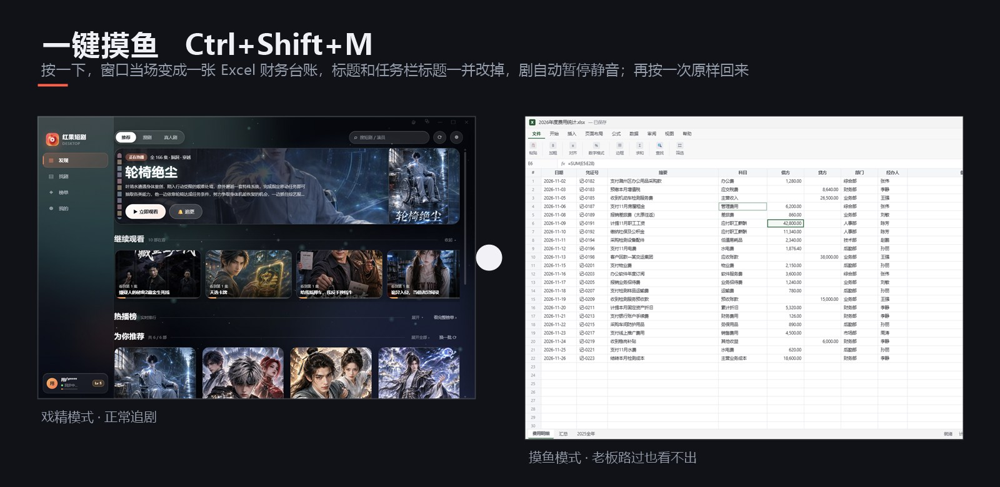
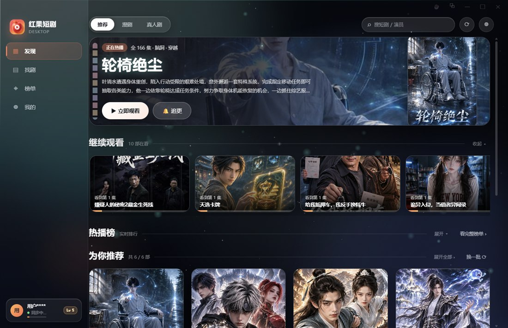
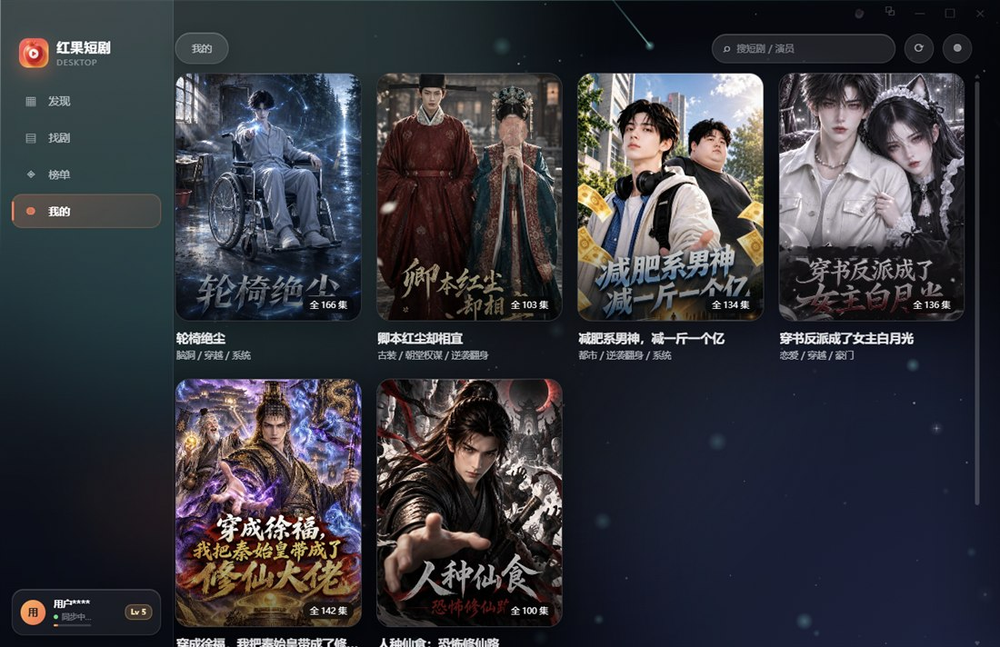
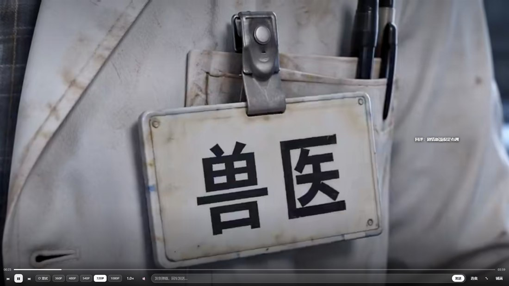

# 红果短剧・桌面皮肤版｜一键变 Excel（hongguo-skin）

> 官方客户端一个字没动，功能全保留，只是把那张"呆板的脸"换了。
> 纯前端换皮 + 一层很薄的 C# 外壳，双击 exe 就能用，不需要 Docker、不需要另起服务。

**当前版本：v1.031**（2026-11-23）　

> **项目主页**：https://guhang42-jpg.github.io/hongguo-desktop-skin/　（截图、能力、版本时间线都在这页）

## 下载

- 最新版：`v1.031` → https://github.com/guhang42-jpg/hongguo-desktop-skin/releases/tag/v1.031
- **轻量版**（不含语义模型，6.99 MB）：`https://github.com/guhang42-jpg/hongguo-desktop-skin/releases/download/v1.031/hongguo-skin-1.031-win64.zip`
  - SHA256：`9587F25F4D9765CC9B8A4D209871D8D218737A506086EB9594F78CC71E0A0BF5`（6,985,196 B）
- **语义版**（含本机模型，25.4 MB）：`https://github.com/guhang42-jpg/hongguo-desktop-skin/releases/download/v1.031/hongguo-skin-1.031-win64-ai.zip`
  - SHA256：`D8DEF4690A426FBB1A0B83BF6EA145BB361EFE8C5C1D856F6CA38C2045323E5B`（25,409,883 B）
  - 小果能认得从没说过的说法、能听懂"开局很惨后来翻身的"这种没剧名的话；不装模型也能用，只是换个说法就不一定接得住
- 上一版（v1.030）：https://github.com/guhang42-jpg/hongguo-desktop-skin/releases/tag/v1.030

> **系统要求：Windows 10 及以上。** 低于 Win10 会直接弹说明并退出，不再装完之后才发现打不开 —— 原因见「更新日志 v1.030」，不是缺运行库、也不是文件坏了，是 core 的运行时和界面内核都不支持。

> **一键摸鱼**：任意时候按 `Ctrl+Shift+M`，窗口当场变成一张 Excel 财务台账（标题、任务栏标题一并改掉，剧也顺手暂停静音）；再按一次原样回来。顶栏那颗 ☕ 也是同一个开关。



> **换到别的 Windows 电脑上播放只有声音、画面全黑？** 那台机器缺 HEVC 解码器（片源是 H.265）。
> 启动后顶上会顶出一条橙色提示，点「去安装」拉商店装 `HEVC Video Extensions`（￥0），装完点「装好了，重启」即可。


解压后目录长这样：

```
红果短剧.exe                     ← 双击这个
Microsoft.Web.WebView2.Core.dll
Microsoft.Web.WebView2.WinForms.dll
WebView2Loader.dll
core/hongguo-tv-core.exe         ← 官方数据核心，原封不动
ui/index.html, ui/app.js, ui/icon.png
ui/version.txt                   ← 程序自己的版本号，更新检查要用
ui/ai/                           ← 只有语义版有：24 MB 模型 + 11.8 MB 运行时
```

## 截图

| 发现页 | 找剧 · 分类筛选 |
|---|---|
|  |  |

| 榜单 · 分类排行 | 我的追剧 |
|---|---|
|  |  |

| 剧场播放 · 真全屏 | 小窗模式（右下角挂机） |
|---|---|
|  |  |

| 小果（本机剧库助理） | 问它一部剧讲什么 |
|---|---|
|  |  |

| 没剧名也能问（语义版） | 「找部修仙的」 |
|---|---|
|  |  |

| 换个说法也认得（语义版） | 她记得你说过什么 |
|---|---|
|  |  |

## 这版有什么

工程：

- **播放失败说人话，并给一条能顶上的路**（v1.031）：core 那十几个内部 stage 码（`VIDEO_MODEL_EMPTY` / `VIDEO_MODEL_HTTP` / `VIDEO_MODEL_READ` / `VIDEO_MODEL_JSON` / `VIDEO_MODEL_SIGN` / `VIDEO_TAB_EMPTY` / `DEVICE_REGISTER_FAILED` / `MEDIA_DECRYPT_FAILED` / `FALLBACK_API_*`）直接甩在页面上等于没说，现在统一翻成「一句中文 + 原码」；判定是上游返空时，明说「所有线路和清晰度拿到的都是同一个空响应，是官方片源侧的问题，不是这台机器、也不是登录态」，并多给一颗「↗ 打开官方网页」顶上（外壳白名单从只放 GitHub 扩到 GitHub + 红果官方站）
- **「点集数没反应」补上反馈**（v1.031）：分集数据不全时 `loadStream` 原来是静默 `return`，点哪一集都像卡住；现在浮层和气泡都说清「这一集缺视频号，重开详情取全再试」
- **启动先验系统，失败给诊断**（v1.030）：`ntdll!RtlGetVersion` 读真实版本（绕开未 manifest 程序在 Win8 以上一律谎报 6.2 的老毛病），低于 Win10 直接一个说明框退出，装之前就知道装不了；真要折腾可带 `--force`。core 起不来时弹窗不再只写「看 app.log」，而是给出系统版本、退出码人话（`0xC0000135` 缺 DLL / `0xC0000139` 缺入口点 / `0xC000001D` 不认识的指令 / `0x80070005` 被杀软拦）、core 自己吐的最后 6 行，以及「确定」直接拿记事本打开日志。另外能认出 Go 崩溃的指纹（`PC=0x0` + `runtime.asmstdcall`），一句话说成「它调了一个这台机器上没有的函数」
- **v1.028 那版的自查修复**（v1.029）：补推理串行锁（连打字不再并发 run 同一会话）、体检行允许折行（原来被 230px 截成「…」）、进设置·本机自动把模型点着、失败后 30 秒内不重复读 22MB、状态复位补全、重载按钮按结果说话、超时文案不再写「0s」
- **语义检索补上四道约束**（v1.028）：门槛（内存 <4GB 自动降级，单句超时收到 5s）、指纹（`ui\ai\manifest.json` 记 SHA-256，模型对不上就拒绝建会话，坏 onnx 不再静默吐 NaN）、超时（清单 4s / 读模型 15s / 建会话 12s / 整链 22s / 单句 8s，超时退回关键词）、体检行（设置·本机新增「语义检索」一栏：状态徽标 + `模型 22.8MB · 指纹 一致 · 线程 1 · 加载 1.2s · 单句 38ms · 库内 1130 部` + 超时次数 + 重载按钮）。不新增功能，只让它坏得明白、慢得有上限

界面：

- **「我的」页照官方形态重做**（v1.031）：追剧 / 收藏两个大字 tab（26px，未选 46% 灰、选中纯白加重），tab 行右端一颗圆形搜索钮（点开就是本页输入框，边打边筛，`Esc` 收起）；第二行筛选胶囊「全部 / 已看完 / 未看完」选中态改成橙字 + 半透明橙底、去掉描边（照官方那种"橙字压深橙底"），右侧是计数 + 网格/列表视图切换 + 竖分隔 + 「管理」（默认纯文字，进管理模式才变白底药丸）
- **管理模式的批量动作按能力分级**（v1.031）：收藏 tab 走「取消收藏」（回写 core），追剧 tab 只做「从本机隐藏」（只动这台机器的列表，底部写明云端记录还在），隐藏后 chips 行出现「恢复 N」
- **一千部不会一次全铺**（v1.031）：默认 40 部，底部「再看 40 部（还剩 N 部）」，切 tab / 切筛选自动回到 40
- **成就墙折叠成一行横滑**（v1.031）：折叠态原来也要占 4 行、把追剧列表压到屏幕最底下只露一排；现在横排一行、拖一下看全，展开照样 45 项全铺
- **长剧的段按钮不再横向滚**（v1.027）：「1-24 / 25-48 / …」原来排成一行到底、底下一条细滚动条正压在按钮边上；现在改成自动换行 —— 126 集 6 段还是一行，301 集 13 段折成两行，711 集同理，滚动条彻底没了
- **顶栏三颗图标收口**（v1.027）：刷新 `⟳`、账号 `◍` 两个字符图标换成与齿轮同一套的线性矢量（线宽 1.7），粗细、留白、圆心终于对得上
- **圆钮更好点**（v1.027）：可见还是 28px，透明热区外扩 6px（实际 40px），点偏一点也能中；气泡改成朝上弹，不再压住下一行卡片
- **成就墙不再铺满三屏**（v1.027）：默认只露「已解锁（按拿到的时间倒序）+ 3 个最容易拿的」，计数改成 `28 / 45　还有 17 项未解锁`；右上圆钮展开后照样全铺 45 项
- **小节标题右边不再是文字按钮**（v1.026）：「收起」「展开全部」「换一批」全换成 28px 圆钮 —— 一圈细边、13px 线性图标（刷新 / 更多 / 上下一集方向），hover 提亮、按下缩一点，气泡走上一版那张自绘提示。一个按钮只说一件事，眼睛不用先读字
- **空态有了统一样子**（v1.026）：居中一枚 66px 圆形图标 + 一句话 + 一枚胶囊按钮（「去找剧」「去发现」「导入」那一套），红果的搜索无结果、「我的」页收藏/记录为空都换成它，不再是一行灰字
- **新加一整页设置面板**（v1.026）：从顶栏齿轮进，左侧分组导航（界面 / 播放 / 本机 / 高级），右侧分组卡 + 行项 + 右箭头取值 + `kbd` 快捷键小方块；「详情页封面糊底」「热播榜默认收起」「进播放页直接全屏」「画面铺满」「默认线路」都能当场开关，`Esc` 直接收起
- **设置页底部那块版本区**（v1.026）：本机版本号 + 构建号 + 「还没检查过 / 已经是最新 / 发现有新版」状态，右边并排「重新检查」和「打开下载页」——版本推送不再只靠托盘气泡和点开浏览器
- 左侧固定导航 + 品牌标 + 底部账号卡；顶部胶囊标签 + 搜索 + 账号
- **左侧栏收成 68px 图标窄条**：只留 logo、四个线性图标（罗盘 / 放大镜 / 柱状 / 人像）、小果那颗球、底部头像，全在 x=34 这条竖线上。**v1.024 起不再整条铺开**——鼠标压到哪一项，就在那一项右边浮一个小标签（发现 / 找剧 / 榜单 / 我的 / 小果 · 本机助理），移开即收，主内容一点不被压住。小窗模式下同样只留纯图标栏
- **播放页与详情页的竖栏统一成 64px 图标条**：宽度、按钮尺寸、分隔线、直角完全一致；剧名与按钮文字都改成悬停浮出的小标签，不再整条铺开盖住内容
- **详情页整块面板有了气氛底**（v1.025）：当前这部剧的封面放大 16%、模糊 44px、压到 0.86 亮度铺满，再叠一道自上而下的深色遮罩 —— 换剧就换色，正文照样读得清
- **播放页左上是一张迷你"正在播放"卡**（v1.025）：小封面 + 剧名 + 第 N 集 / 共 N 集，和返回钮齐平；顶栏显形它就在，静置一会儿连人带卡一起淡出
- **播放页右缘一条竖窄队列**（v1.025）：一集一格，贴右边缘才浮出，当前集白底、看过的格底一条橙色进度线，点一下直接切集，全屏切集保持全屏
- 大 Hero、继续观看横滑、热播榜带名次横条、推荐瀑布流、底部悬浮播放条
- **首页折叠**：热播榜默认收起、推荐区只露两行，点了才展开；找剧 / 榜单 / 我的页不再摆 Hero 和两条横滑
- **找剧细化**：排序（推荐 / 热度 / 口碑 / 集数少 / 集数多）+ 集数段（≤40 / 41–80 / 80+）+ 题材标签（从已加载剧集里统计出的热门前 10）
- **榜单细化**：综合榜 / 真人剧榜 / 漫剧榜 / 官方推荐榜 + 官方推荐序 / 最热播 / 口碑高 / 短剧精选 / 长剧专场；卡片左上角有名次牌（前三金 / 银 / 铜），跟上次打开时的顺序比对出名次涨跌
- **详情页多季切换**：同一部剧的第 1..N 季横排，点了直接换季；未上线的续季灰着并提示
- **选集按 10 集分段**：长剧不再一次铺几十个按钮，`1-10 / 11-20 …` 分段条，看过的集标成暖色
- 整窗毛玻璃质感 + 深空底色统一，窗口边缘直角不圆润（Win11 的 DWM 圆角也关掉了）
- 幽光 / 星空 / 流星 / 光尘动态背景，按剧的类型换配色，播放时更活跃，鼠标有视差
- **小果**：侧栏「我的」下面一颗小球，点开是一卷往上长出来的对话气泡。查你看到哪了、按关键词或集数找剧、翻收藏、报本机记录，说「看《XX》」直接开播。**不联网、不带常驻进程**，全部走 core 的本地接口
- 小果的对话框是一块**玻璃**：半透明底 + 背景模糊 + 一层薄膜厚度，没有描边；说话气泡左右分色、各带一个朝向说话人的尖角，尾巴和气泡同色零重叠，放大也看不出接缝
- **小果还会"按意思找剧"（语义版独有）**：装 `ui/ai/` 之后，它带一个 24 MB 的本机向量模型 —— 说「有没有那种开局很惨后来翻身的」「宫斗的，娘娘那种」都能挑出对的剧，不看剧名。开面板时它顺手把模型热起来（约 0.47 s），问一句单句编码 13–39 ms，1130 部剧全在内存里点积，不联网、不占显存；不装 `ui/ai/` 就完全安静，不报错也不占内存
- **她记得住你**：你说「我爱看修仙的」「别给我推太长的」，它会记下来，并在气泡底部回一句「记下了：爱看修仙的」；下次开面板开场白会带一句「我记得你说过「不喜欢太长的」」。问「你记得什么」能看全部，说「忘了吧」一次全清。**不用模型抽取，两条正则 + 去重累加，整块记忆不到 10 KB，存在本机 localStorage 里，不联网、不上传**
- **她会等你**：隔了三天没来，开场白是「三天没见着你了」；隔七天是「你有 N 天没来了」；凌晨开是「这个点还没睡」；一天聊过五次以上是「又来了」。**同一种话一天只准说一次**，开开关关不会被复读
- **她也有点情绪**：亲密度（开口 +1 / 说话 +2 / 真点开一部剧 +3，隔天不来会扣）分生 / 熟 / 亲三档，档位直接改头像光晕的冷暖与饱和度 —— 情绪是两个能核对出来的数字，不是编出来的形容词
- **对话面板按内容收缩**：只开面板不问话时不再固定一大片高度，按真实内容算高（内容多才封顶转滚动），伸缩带过渡
- **记忆能拿出来看**：每次变化后 1.2 秒去抖，另写一份到 `%APPDATA%\HonggoDesktop\xiaoguo-memory.md`（人话版）和 `.json`（可回灌版），能打开核对；本地存储万一空了就从这个文件兜底恢复。md 是快照，手改不生效，想清空还是说「忘了吧」
- **「推荐一部」不再随口给**：把"推荐 / 来一部 / 随便 / 好看"这些泛词剥完什么都不剩时，才承认这是句空话，然后按你记过的偏好去找 —— 「爱看修仙的」剥成 `修仙` 当语义种子，记过「不喜欢太长的」就真的按集数升序挑
- **你不来找她也会吭一声**：托盘图标常驻（右键：打开小果 / 随便挑一部 / 今天别打扰我 / 退出）。每 45 分钟醒一次，只比记忆里的几个时间戳，**不截屏、不联网、不调模型**；8:00–22:00 之外一句话不说，一天最多一句，摸鱼态、看片中、小窗挂机都不打扰。点气泡会把窗口唤起来，并自动问一句「推荐一部」，直接出卡。不想要托盘就 `--notray` 完全关掉；点 X 仍是真退出，不留后台
- **出新版了它会自己说**：程序把自己版本号读 `ui/version.txt`，界面起来 12 秒后去仓库根目录读一次 `version.json`（十几 KB，超时 12 秒、静默失败），比自己高就在顶部胶囊换成「新版 vX 出来了 · 点这里看看」——暖橙边框、能点、停 9 秒，托盘同时冒一个气泡，点哪儿都是打开 Release 页。**只放行 `https://github.com/` 开头的链接**，界面别想借这台机器开任意程序。不做自动下载、不碰自己的 exe，`--noupd` 整套关掉
- 上面这条是**唯一**一处外连：只 GET 那一个 JSON，不带你看了什么剧、记了什么偏好，不统计。托盘右键也有「检查更新」可以手动点一次
- **仓库有主页了**：`docs/index.html` 走 GitHub Pages，深色玻璃风，一页说完是什么、截图墙、能干什么、版本时间线，单文件零依赖
- **说的剧名能点进去**：开场白、追剧追问里那句「你上次停在《某部剧》第 109 集」，书名号里的字是暖橙色的链接，点一下面板关掉、右侧详情抽屉打开，选集直接落在那一集（`touch("play")` 顺手记一笔）。老会话里存下来的旧消息没有锚点，点了按书名号里的字回库里认一次再跳，认不出就当普通文字放过 —— 宁可没反应，也不跳错剧

播放：

- **打开即真全屏 + 铺满裁剪 + 自动播放**（想回面板方式，把 `ui/app.js` 里的 `AUTO_FS` 改成 false）
- **播完直接接下一集**：没有读秒倒计时，画面原地换源，不退回面板、不闪海报
- **每集都从头开始**：换集先卸旧源再归零，实测三集 `t0 = 0.00`
- **续播记忆**：同一集看到一半退出，下次点这集从上次位置继续；详情页播放键会写「继续看 00:15」，看过的集在选集中标暖色
- **倍速 + 音量**：`1.0× / 1.25× / 1.5× / 2× / 0.75×` 循环（`R`），音量有滑条（点喇叭弹出，拖完记住），滚轮也能调，`M` 一键静音
- 小窗（430×780 置顶、半透明沉浸、控件自动收起）与全屏互切不再打架：两种形态互斥，退出全屏会退回你来的那个形态
- 画面三档：原比例 / 铺满裁剪 / 拉伸
- 弹幕默认开，`D` 开关（原来顶部那颗「弹幕 开」按钮已拿掉，不占位置）
- 单集播到最后一个会提示「已经是最后一集」，不会无声停住

成长系统（自娱自乐的小东西）：

- 等级：`need(lv) = 120 + 80(lv-1) + 8(lv-1)²`，9 档称号，越往后越吃经验
- 经验：看 1 分钟 +4、1 集 +8、收藏/追更 +15、弹幕 +4、每日签到 +30、成就 +30
- 45 个成就：完播、连刷、考古回看、题材杂食、时段彩蛋、玩法模式（小窗/全屏/三档/搜索/榜单/云同步）等

## 使用说明

1. 解压到任意目录（别放中文路径的老式短目录，其它都行）
2. 需要 **WebView2 Runtime**（Win10/11 一般自带，没有就装一下微软官方的 Evergreen Runtime）
3. 双击 `红果短剧.exe`，外壳会自动拉起 `core/hongguo-tv-core.exe`，然后打开界面
4. 登录、云同步、追更收藏、播放进度都走官方核心，跟原版共用一份本地数据目录

快捷键：`F` 全屏 / `Esc` 退全屏或小窗 / `空格` 播放暂停 / `←` `→` 上一集下一集 / `D` 弹幕 / `R` 倍速 / `M` 静音 / `/` 搜索框

## 开发碎语

老实说这活儿的起点挺憋屈的：原版是 Wails 打包的，前端被编进 exe 里，发布仓库又不带前端源码，外面根本改不动它的 UI。

好在 `hongguo-tv-core.exe` 本身就是个本地 HTTP 服务，随机端口上既吐它自己的前端，也吐 `/api/v1/*`。我一开始想另起一个静态服务去调接口，结果被跨源挡得死死的——`account`、`library`、`lists/recommend` 一律回"只允许应用本身访问账号和记录"，`file://` 也一样 `Failed to fetch`。

最后的路子很简单：既然不能跨源，那就**不跨源**。C# 外壳把 `coreUrl + "/skin/*"` 拦下来映射到本地 `ui/` 目录，页面依旧算 core 的同源，接口全通。于是官方能力一点没丢，我只需要专心画皮。

踩过的坑，留给以后的自己：

- 封面很多是 HEIC，WebView2 直接摆烂，必须优先用 `cover_fallback` 那张 JPEG
- `play/info` 返回的 codec 是 `bytevc1`，`mode=compat` 没效果，别试了
- 换集时别把上一集的 `currentTime` 带过去，不然新一集一开场就"播完"，看着像自动跳集
- Win11 的 DWM 会给无边框窗口套一层大圆角，得用 `DwmSetWindowAttribute(33/34)` 手动关掉
- 任务栏图标认的是窗口图标，光给 exe 换 `/win32icon` 不够，还得显式 `Form.Icon`
- `ort.env.wasm.wasmPaths` 给字符串 `"ai/"` 会挂：ort 内部用动态 `import()` 加载 `.mjs`，`ai/...` 被当成裸模块名解析失败。必须给 `{mjs, wasm}` 对象 + 绝对 URL，顺带把 jsep（WebGPU）版绕掉
- `Xenova/bge-small-zh-v1.5` 的 `vocab.txt` 和 `tokenizer.json` 里 vocab 不一致（前者有 `[unused58]` 占位、没有 `58` 整词），WordPiece 会乱切数字。得从 `tokenizer.json` 的 `model.vocab` 重建词表
- 想按内容自适应面板高度，别用 `body.scrollHeight` 量：内容没溢出时它等于容器高度，算出来永远等于当前高度，改不动。得用子元素 `offsetHeight` 求和，只在真溢出时才拿 `scrollHeight` 兜底；固定部分（头部 / 短语行 / 输入区）也别写死，用 `pop.offsetHeight - body.offsetHeight` 实测

## 已知限制

- 这是**非官方**的第三方界面项目，官方随时可能换接口或核心版本，挂了就等我跟进
- 播放要用官方核心取流，所以第一次启动会多一个后台进程，它是官方的，别误杀
- 4K/杜比这类官方没有的档位自然也没有；1080P 能不能出取决于剧本身

## 免责声明（侵权立删）

- 本项目仅做**客户端界面研究与个人使用**，不包含任何破解、不绕过付费、不二次分发剧集内容。
- 所有影视内容、商标、数据接口版权归**红果短剧 / 番茄**及其权利人所有。`core/hongguo-tv-core.exe` 为官方发布的组件，原样引用，未做修改。
- 本仓库代码仅用于学习交流，**请勿用于商业用途**。
- 若权利人认为本仓库或发布物侵犯其权益，请通过 Issue 或邮件联系我，我会在收到通知后 **24 小时内删除仓库与全部发布物**（侵权立删，不需要解释）。

## 更新日志

### v1.031（2026-11-23）

这一版两件事：把「我的」页按官方那两行的形态补齐，以及把播放失败这件最容易被说成"没反应"的事讲清楚。

- **「我的」页照官方形态重做**：追剧 / 收藏两个大字 tab，26px、未选 46% 灰、选中纯白加粗；tab 行右端一颗 32px 圆形搜索钮（官方那颗放大镜的位置），点开是本页输入框，按剧名边打边筛，`Esc` 收起。第二行筛选胶囊「全部 / 已看完 / 未看完」，选中态从原来的"橙细边 + 浅橙底"改成官方那种「橙字压半透明橙底、无边框」，右侧依次是计数（`共 996 部` / `已看完 N 部`）/ 网格-列表视图切换 / 竖分隔 / 「管理」。管理默认纯文字，进管理模式才变白底药丸。
- **管理模式的批量动作按能力分级**：收藏 tab 走「取消收藏」，真的回写 core 的收藏位；追剧 tab 只做「从本机隐藏」（localStorage，不动云端），底部条上写明"云端记录还在"，隐藏后 chips 行会多一个「恢复 N」，点了放回来。不造"能删"的假动作。
- **一千部不会一次全铺**：原来网格硬切 60 部、列表全渲染，计数写 996 却只能翻到前 60 张。现在默认 40 部，底部一颗「再看 40 部（还剩 N 部）」，切 tab / 切筛选自动回到 40。
- **成就墙折叠态改成一行横滑**：折叠时原来也要占 4 行（约 200px），加上档案卡把追剧列表压到屏幕最底下、只露一排卡片。现在折叠态横着排一行、可拖动，展开照样 45 项全铺；`28 / 45　还有 17 项未解锁` 的计数不变。
- **播放失败不再只甩错误码**：core 的内部 stage 码（`VIDEO_MODEL_EMPTY`、`VIDEO_MODEL_HTTP`、`VIDEO_MODEL_READ`、`VIDEO_MODEL_JSON`、`VIDEO_MODEL_SIGN`、`VIDEO_TAB_EMPTY`、`DEVICE_REGISTER_FAILED`、`MEDIA_DECRYPT_FAILED`、`FALLBACK_API_*`）统一翻成「一句中文 + 原码」。判断是上游返空时，直接写明"所有线路和清晰度拿到的都是同一个空响应，是官方片源侧的问题，不是这台机器也不是登录态"，并多给一颗「↗ 打开官方网页」（外壳的链接白名单从只放 GitHub 扩到 GitHub + 红果官方站）。
- **「点集数没反应」补上反馈**：分集数据不全时 `loadStream` 里原来是 `if (!vid) return;` —— 点了等于没点，用户只会以为程序卡住。现在浮层和气泡都说清"这一集缺视频号，退回列表重开详情取全再试"。

**已知情况（不是这一版引入的）**：本轮实测 `GET /api/v1/play/info` 对任意剧、任意画质、`mode=full|range`、`fallback=0|1` 一律返回 `502 {"error":"VIDEO_MODEL_EMPTY","preparation":{"http_status":200,"response_bytes":0,"elapsed_ms":60~80}}` —— 上游回了 HTTP 200 但 body 是空的。同机 `series/detail`、`lists/recommend`、`lists/rank`、`library`（1138 条）全部正常，`account` 显示 `logged_in:true`，所以不是网络、不是登录、也不是 core 版本（1.026~1.030 里的 `hongguo-tv-core.exe` 都是同一个 `0.2.177-737acc2…`，行为一致）。这条链路在 core 二进制内部（Go，无源码），皮肤版改不了；能做的就是上面那两条把它说明白，并让官方网页顶上。

### v1.030（2026-11-23）

有人在 Windows 7 上装了一套，弹的是「内置服务没有启动起来，无法继续，请查看目录里的 app.log」。拿到日志才看清真正原因，所以这版主要做两件事：把门槛说在人脸上，把失败说到能定位。

- **为什么 Win7 上一定起不来**：`core\hongguo-tv-core.exe` 是 **Go 1.25.14** 编译的（二进制里带 `go1.25.14` 与 `Go build ID`），只依赖 `kernel32.dll`，静态导入的 47 个函数全是 Win7 也有的老 API —— 所以不是「缺 DLL / 缺入口点」那种加载期就死的情况。它的死法是：Go 运行时用 `WaitOnAddress` / `WakeByAddressSingle` 做信号量，这两个是 **Win8 才加入 kernel32** 的，Go 在 Win7 上取到空指针后直接跳过去，于是
  ```
  Exception 0xc0000005 0x8 0x0 0x0
  PC=0x0
  runtime.asmstdcall(...)
      runtime/sys_windows_amd64.s:76 +0x89
  ```
  `rip 0x0`，退出码 2。这条路补不了：用户态伪造同步原语没有意义，不是放个转发 DLL 能过的事。第二道墙是界面内核 WebView2，微软 2023 年 1 月停止支持 Win7，最后能装的只有 109 版。
- **启动先验系统**：用 `ntdll!RtlGetVersion` 读真实版本号（未 manifest 的程序走 `Environment.OSVersion`，在 Win8 以上会一律谎报 6.2，必须绕开）。低于 Win10 时一个说明框直接退出，讲清是 core 的运行时和界面内核不支持、换台 Win10/11 的机器就行；想自己折腾可带 `--force` 启动，崩溃全文照旧写进 `app.log`。
- **失败弹窗改成诊断**：原来是「请查看目录里的 app.log」，等于把问题整个丢给用户。现在给出系统版本、core 退出码并翻成人话（`0xC0000135` 找不到依赖的 DLL、`0xC0000139` DLL 里缺入口点、`0xC000007B` 位数不对、`0xC000001D` 执行了不认识的指令、`0xC0000409` 触发缓冲区检查、`0x80070005` 可能被杀毒软件拦）、core 自己吐的最后 6 行，下面「确定」直接用记事本打开 `app.log`。
- **认得出 Go 崩溃的指纹**：日志里出现 `PC=0x0` 或 `runtime.asmstdcall` 就判定为「调了这台机器上没有的函数」，不再显示一屏寄存器让人自己猜；低于 Win10 时再补一句「系统太旧，补 DLL 补不出来」。
- **启动日志带系统信息**：每次开窗口第一行写 `窗口已创建  Windows 11 10.0 build=26200`，以后任何机器上的问题都能先看这一行。
- **重试等待收紧**：core 退出事件本身能立刻结束等待（实测 Win7 上三次尝试共 4 秒，不是原先估计的四十多秒），所以这里只是把单次上限从 15s 收到 9s、老系统只试一次 8s，少写三份重复的崩溃块。
- 只动外壳 `build\App.cs` 与 `ui\version.txt` / `ui\build.txt`；`core`、界面、语义模块一行未改。

### v1.029（2026-11-23）

- **推理串行锁**：新增 `encQ()` 走 `lock` 队列，同一 wasm 会话同一时刻只允许一条 `run`；`reset()` 重置队列，卡死的旧 run 不再挡住新推理
- **体检行折行**：`.row .mono.wide` 取消 230px 上限与 `nowrap`，`模型 22.8MB · 指纹 一致 · 线程 1 · 加载 1.2s · 单句 38ms · 库内 1130 部` 不再被省略号截断
- **进设置自动预载**：打开「本机」页静默 `boot()`，`setTick` 每 1.2s 重绘到加载完成；轻量版 404 → 标「本机版没装模型」
- **失败冷却**：新增 `st.errAt`，失败后 30 秒内 `boot()` 直接返回上次状态，不再每次搜索都重读 22.8MB；`reset()` 清掉时间戳
- **状态复位补全**：`boot()` 清 `fp / missing / it / encMs / errAt`，`reset()` 再清 `mb / loadMs`
- **重载文案**：按结果分支 —— 成功 / 没带模型 / 没加载起来（带原因前 22 字）
- **超时文案**：`within()` 的 `<1000ms` 走毫秒（原来 120ms 会写成「0s」）
- **分组顺序**：「语义检索」移到「数据」之后
- 校验方式：把 `within` / `sha256` 从 `app.js` 抠出来在 node 里实测（超时 flag、reject 透传、1MB buffer 指纹与 node 原生一致）；`node --check` exit 0；三处 `model.onnx` 与三份 `manifest.json` 完全一致
- 只动 `ui\app.js` / `ui\index.html` / `ui\version.txt` / `ui\build.txt`，外壳 exe、本地 core、播放链路未碰

### v1.028（2026-11-23）

- **门槛**：读 `navigator.deviceMemory`，< 4GB 进降级档，单句推理超时 8s → 5s，体检行标黄「低内存 · 已降级」；拿不到该值时按正常档，不误判
- **指纹**：新增 `ui\ai\manifest.json`（`model.onnx` / `vectors.bin` / `vocab.txt` / `index.json` / `intents.bin` 的字节数与 SHA-256）；`boot()` 里用 `crypto.subtle.digest` 校验 `model.onnx`，不符即抛错、拒绝建会话 —— 坏 onnx 原本会静默出 NaN、语义永远返回空
- **超时**：新增 `within(p, ms, tag)` 包装，清单 4s / 读模型 15s / 建会话 12s / 整链 22s / 单句 8s（降级 5s）；`top()` / `intent()` 超时返回空，上层 `findSem` 的 `.catch` 自然退回关键词
- **体检行**：设置·本机新增「语义检索」组 —— 状态徽标（就绪 / 加载中 · 读模型 / 本机版没装模型 / 指纹不符 / 低内存）、体检行 `模型 22.8MB · 指纹 一致 · 线程 1 · 加载 1.2s · 单句 38ms · 库内 1130 部`、超时次数、`重载` 按钮；新增 `.row .spill` 三色徽标样式
- **顺带**：`SEM.reset()` 先 `sess.release()` 再重建；加载日志补 `fp=` / `mb=`；`ui\version.txt` 1.028、`ui\build.txt` `1.028 · 2026-11-23`
- 这版只动 `ui\app.js` / `ui\index.html` 并新增 `ui\ai\manifest.json`，外壳 exe、本地 core、播放链路未碰

### v1.027（2026-11-23）

- **长剧段按钮换行**：`.epsegs` 从 `overflow-x:auto` 改 `flex-wrap:wrap`，间距 8×6、按钮高 30→28、左右内距 12→10、字号 12→11.5；126 集 6 段仍单行，301 集 13 段折两行（8+5），横向滚动条与「压住按钮底边」的问题一并消失
- **顶栏图标矢量化**：刷新 `⟳` → rotate-cw、账号 `◍` → user，与齿轮同为一像素线性 SVG（线宽 1.7、16px）；新增 `.ic svg` 统一尺寸与 `pointer-events:none`
- **圆钮热区外扩**：`.sec .tb` 加 `position:relative`，`::after{inset:-6px}` 撑成 40px 透明可点圆，视觉仍是 28px 一圈
- **气泡改朝上**：提示的 `place()` 判断触发点是否为 `.tb`，是则优先排到钮上方 16px，上方真放不下才回落下方；标题行的气泡不再压下一行卡片
- **成就墙收窄**：新增 `paintAch()` —— 折叠态只渲染「已解锁（按 `D.ach` 时间戳倒序）+ 未解锁按定义顺序前 3」，展开态全铺 45 项；计数改 `28 / 45　还有 17 项未解锁`；`#achFold` 由 `.foldbtn` 文字按钮换成 `.tb` 圆钮 + chevron，`data-dir` / `data-hint` 随状态切换
- 顺带修：删掉 v1.026 遗留的 `.achgrid.fold .ach:nth-child(n+17)`（它会把 JS 渲染的 31 格又砍回 16 格），兜底放宽到 `n+64`；计数文案由「减 3」改成未解锁总数，与 `N / 45` 自洽
- 这版只动 `ui\index.html` / `ui\app.js`，外壳 `红果短剧.exe` 与 v1.026 同一个，播放链路、AI、本地 core 都未触碰

### v1.026（2026-11-23）

- **小节标题右边只留一个圆钮**：继续观看 / 热播榜 / 推荐区的「收起」「展开全部」「换一批」全换成 28px 圆钮，13px 线性图标、一像素细边、底子只加 5% 白；hover 提亮 + 放大 7%，按下缩到 94%，折叠方向靠图标转 180° 表达，配上一版那张自绘气泡，不再靠三个字说明自己
- **空态三件套落地**：新增统一空态组件（居中 66px 圆形图标 + 一句话说明 + 一枚胶囊按钮），搜索无结果、「我的」页收藏为空/没有观看记录都换它；图标按语境取放大镜 / 胶片 / 心 / 播放，按钮直接把人带到「去找剧」「去发现」
- **设置面板（照 Folia 那套排的）**：顶栏齿轮进入，宽度 620px 从右侧滑入（0.34s），左侧 132px 分组导航四组（界面 / 播放 / 本机 / 高级），右侧标题 + 关闭 + 滚动分组卡；行项左标题右操作、描述一行灰字、分隔线只给 5% 白，快捷键用 `kbd` 等宽小方块
  - 界面组：开关「详情页封面糊底」（关掉就不铺气氛底）、开关「热播榜默认收起」，两行只读说明左侧栏与详情面板的实际尺寸
  - 播放组：开关「进播放页直接全屏」、「画面铺满」（铺满 / 适应，立刻生效并写进本地）、「默认线路」（高清完整 / 高清分段 / 标清完整），下面列真实快捷键 8 行
  - 本机组：数据目录、本地接口、看过多少集多少部（只读），「清空观看记录」「小果的记忆」两个动作行
  - 高级组：版本检查方式、上次检查时间、三个文件名，以及「现在检查一次」
- **设置页底部版本块**：左边本机版本号 `v1.026` + 构建号，右边状态位（还没检查过 / 已经是最新 / 发现有新版 vX）并排「重新检查」「打开下载页」；发现新版时状态位变橙，点「打开下载页」走外壳放行的链接，不再只靠托盘气泡
- 顺带修：设置面板 z-index 抬到播放容器之上（播放态打开不会被压住）；分组卡不再被 flex 压缩吃掉行高（描述文字不再被裁）；分组卡行项的小圆钮、开关、seg 都补了 `data-hint` 气泡
- 顶栏右侧在原本的刷新 / 主题 / 摸鱼之外，加了一颗齿轮作为设置入口；`Esc` 收起设置面板，不影响播放页原有的分级 Esc

### v1.025（2026-11-23）

- **详情页有了气氛底**：当前这部剧的封面放大、模糊、压暗后铺满整个面板，切剧就跟着换色；下半截再压一道自上而下的深色遮罩，正文一点不吃亏
- **播放页左上那颗剧名浮标签，升级成一张迷你卡**：40×53 的小封面 + 剧名 + 「第 N 集 · 共 126 集」，跟返回钮同一行、同一高度；顶栏显形它就跟着显形，点下一集、切集都即时改写
- **播放页右缘加了竖窄集数队列**：一集一格、30×26 小方块，贴着右边缘；平时收着（鼠标贴到右缘 96px 内才浮出、移开 0.26 秒收回），当前集白底深字，看过的格底一条细橙线按进度，鼠标静置 3 秒跟着顶栏一起淡出，不挡画面
- **点一格就切集**：不用再回详情、不用开选集面板；全屏下切集保持全屏，不会再掉回剧场面板
- 队列会自己把当前集滚到中间，126 集的长剧贴近右缘就能看到「现在第几集、附近哪些看过」

### v1.024（2026-11-23）

- **主界面左条不再整条铺开**：固定 68px，鼠标压到哪一项就在那一项右边浮一个小标签（发现 / 找剧 / 榜单 / 我的 / 小果 · 本机助理），移开即收；主内容不再被抽屉压住
- **详情页底部空出来的地方填上了**：「看完这集，再看看」按题材重合 + 同类型打分，从本机剧库挑 6 部，2 列 3 行横向小卡，点一下直接换剧
- **段按钮会自己报数**：压住「97-120」时标题行右端变成「第 97-120 集 · 看过 1/24 · 看完 1」，不点开也知道这段看到哪
- **看过的集，格底一条细线**：按已存进度画 2px 暖橙线；没记下总时长的一律不画，避免整片选集被糊成橙色
- **播放页底栏只留图标**：选集 `▦`、铺满三态用 `▭ / ▤ / ⤢`，当前是哪一种写在提示里
- **系统灰白 tooltip 全换自绘**：把 `title` 转成 `data-hint` 后摘掉原生提示，改成跟光标走、可换行的深色气泡；左条本来就弹浮标签的项不重复提示
- **首屏骨架屏**：剧库还没回来时先摆一排会呼吸的灰卡，不再是空白干等
- **小窗播放里点开详情自动还原窗口**，顺手给一句「已退出小窗，方便看详情」
- 顺手把「继续观看」卡片的信息行加投影、底下渐变加重，长剧名压到封面亮部也读得清；左条激活态收敛成灰底 + 橙色图标，一条上不再挂三个橙块

### v1.023（2026-11-23）

- **播放页左条 58 → 64**，与详情页同一套：52×52 按钮、18px 图标、右缘极淡分隔线；右侧 18px 圆角改直角
- **播放页不再整条铺开**：剧名 + 集数改成浮标签，只在压住返回钮时浮出，起点 70px 不压按钮
- **选集提示改成就地信息行**：悬停某集时 `选集` 右端从「共 126 集」变成橙色「第 105 集」，有进度时显示「第 110 集 · 上次 0:16」；浮层方案整个撤掉，零遮挡
- 集数格 hover 加强：底色提亮 + 边框加亮 + 上浮 1px
- **修 bug**：`.eptip` 样式曾误嵌进 `.toast` 声明块，导致顶部提示条（已收藏等）整条失效；`#epTip` 节点排在脚本之后拿不到元素；浮标签被容器"可用宽度"压成一百来像素导致长剧名被省略号吃掉 → `width:max-content`
- `vTitleOf` 去掉竖排时代的 9 字截断，剧名一次给全
- 换剧时详情滚回顶部，同剧再开保持阅读位置
### v1.022（2026-11-23）

- **详情面板 580 → 700**：内容区实际多出 120px，选集不再挤在左边一小块
- **选集一段 10 → 24 集**（`EP_SEG`）：8 列 × 3 行铺满右边缘；段按钮变成 `1-24 / 25-48 / …`，126 集只有 6 段，一行放得下，横向滚动条不再出现
- 集数格 `minmax(58px,1fr)` → `minmax(62px,1fr)`，gap 9 → 10
- **左侧图标条 58 → 64**，按钮 46 → 52、图标 17 → 18，右边缘加极淡分隔线；顶部留白 14 → 46 与「详情 · ESC 关闭」齐平
- **取消整条铺开**：`.srail` 固定 64，改成单按钮悬停时右侧浮出深色小标签（播放/收藏/追更/关闭），右侧内容永不被压、也不重排
- 简介与选集段滚动条换成 `scrollbar-width:thin` + 8px 圆角浅色拇指，替掉 Windows 默认灰槽
- 真机三张验证：折叠态 8 列铺满、悬停播放/收藏各浮标签、封面与正文零遮挡

### v1.021（2026-11-23）

- **播放页左侧 96 → 58**：折叠态只剩左上角一枚 36px 返回圆钮，画面左边缘干净 38px；鼠标移上去 `58 → 214` 铺开，露出剧名（190px 内省略号）与 `第 N 集`
- 原来把标题竖着码成 `1.7em` 一行一个字、集数靠负 margin 硬拗位置的做法整个删掉；文字改成 `opacity 0 + translateX(-6px)` → hover 归位
- **详情页左侧 80 → 58**：`▶ / ♡ / 🔔 / ✕` 四个 46×46 图标格，悬停铺到 156 才出文字（播放 / 收藏 / 追更 / 关闭）
- `.srail` 改 `position:absolute` 浮在面板左侧，`.smain{margin-left:58px}` —— 展开时不挤压右侧内容，只盖住自己那 98px
- 详情面板 `556 → 580`，图标条省下的 22px 全给正文；`.sdesc` 的 `max-height` 98 → 112，不再切在半行字上
- 收藏按钮仍用 `<i>♥/♡</i>` 文本节点而不是 SVG：`app.js` 直接往 `querySelector("i")` 写字符，换 SVG 会把图标洗掉
- 真机四张：详情折叠/悬停、播放折叠（1920×1080 全屏）/悬停，右侧内容零位移

### v1.020（2026-11-23）

- **收起方向加 100ms 延迟**（`transition-delay:.1s` 只挂在退出，`hover` 时归零）：鼠标顺着侧栏边缘划一下，抽屉要等 100ms 才动，不再闪一下又退回去
- **展开态底色变实**：`rgba(15,17,24,.72)` / `rgba(9,11,17,.82)` → `.945` / `.965`。原来太透，背后 hero 的「正在热播」胶囊、「全 301 集」会透过抽屉跟导航文字叠在一起
- **小窗（mini）形态禁展开**：`body.mini` 下 hover 不再变宽，文字强制 `opacity:0`。窗口只有 430 宽时铺开 196 会盖掉一半内容
- **`backdrop-filter` 退出过渡列表**：不再逐帧重算 20px 模糊，只在展开态一次性应用；外投阴影 `26px 0 54px -24px` → `18px 0 44px -22px`，模糊 22→20。展开那 340ms 少一轮逐帧重绘
- 图标 hover 由 `scale(1.08)` 改 `translateY(-1px) scale(1.06)`；brand 两行加 3px 行距，与导航之间空隙收紧 4px
- 真机四张截图验证：折叠 / 展开 / 移开 300ms（仍在收）/ 移开 700ms（已复原）

### v1.019（2026-11-23）

- **左侧栏从 104px 竖排文字改成 68px 图标窄条**：`--railw` 一个值改完，栅格第一列、剧场模式的 `left` 一起跟着走，内容区多出 36px
- 鼠标移进侧栏，内层 `.sideIn` 从 68 过渡到 196（`.34s cubic-bezier(.22,.82,.24,1)`），玻璃底淡入、右侧 20px 圆角 + 外投影；移开自己退回 68
- 文字不是被裁出来，是**淡入 + 位移 6px 归位**，比宽度过渡晚 40ms 起，看起来像铺开的同时字浮上来
- 抽屉绝对定位浮在内容上，**不推挤主内容**
- 四个图标换成内联 SVG（罗盘 / 放大镜 / 柱状 / 人像），选中项从"字下面一个点"改成整行橙色渐变块：折叠态 56px 圆角小方框，展开态铺满
- 账号卡改网格 `38px | 1fr | auto`，长名字走省略号，Lv 胶囊不再被挤到文字上面
- 连带修：小果气泡原来按"球左侧 -10"定位，球左移后会压在侧栏上，改成从球右侧 +8 起并夹在窗口内
- 真机三次截图验证：折叠 68 / 悬停 196 / 移开复原，主内容无位移

### v1.018（2026-11-23）

- **气泡里的剧名能点了**：`jp(drama, ep, text)` 统一拼 `<b><a class="jp" data-sid data-ep>《剧名》</a></b>`，开场白 / 追剧追问 / 托盘回合三处同源。点击走事件委托，`preventDefault + stopPropagation`，关面板 → 回库按 `series_id` 认剧 → `touch("play")` → `openDetail(item, ep-1)`
- 样式：`#ffbe7d` 暖橙、底线用 `border-bottom`、hover 变亮、按下回暗，`padding:1px 2px` 把命中区比字面撑开一点
- **老消息也能点**：上一次会话存进 localStorage 的旧消息没有锚点，补了兜底——点到的 `<b>` 里匹配到 `《…》` 就按标题精确回库里认一次，认不出当普通文字放过（不做模糊匹配，宁可没反应也不跳错剧）
- 认不出剧时弹「库里没找到这部剧」，不静默失败
- 真机验证：启动 `--ai` 后 `SetCursorPos + mouse_event` 点剧名，日志三行齐全（`点到了 … 第 110 集` / `打开详情 …` / `库内 1131 条，命中=徒儿对不起，功法是我瞎编的`），截图里详情抽屉打开、选集 101–110 段、第 110 集高亮
- 顺带记一个教训：桌面自动化一直失败的真因是**窗口被最小化**（`GetWindowRect` 返回 `-32000, -32000, 160×28`），点击全打在桌面上。`ShowWindow(SW_RESTORE)` 再取坐标、再置前台、再点，一次命中
- 新增联调参数：`--jump <sid>~<ep>`（直接打开某部剧并定位到某集，正式使用不需要）

### v1.017（2026-11-23）

- **程序知道自己是不是旧的了**：版本号写在 `ui/version.txt`（一行为准），仓库根 `version.json` 五个字段（version / tag / date / url / notes）
- 界面起来 **12 秒后**才去问（不跟启动抢资源，也不会卡开屏），拉 raw 上那个 JSON，超时 12 秒、失败静默；`VerCmp` 逐段比数字，比自己高才算新版
- 有新版的三个提示一起上：顶部胶囊换成「新版 vX 出来了 · 点这里看看」（**暖橙边框、能点、停 9 秒**）、托盘冒气泡、点哪儿都是打开 Release 页
- **只放行 `https://github.com/` 开头的 URL**，其余一律拒绝并记日志——不给界面留"借这台机器开任意程序"的口子
- 托盘右键加「检查更新」，手动查会在托盘回「已经是最新版 vX」或「没连上」；`--noupd` 整套关掉
- **这是本项目唯一的外连**：只 GET 那个十几 KB 的 JSON，不上传任何本机数据（看了什么、记了什么偏好都不带出去）
- **仓库多了主页**：`docs/index.html` 单文件、零依赖、深色玻璃风，走 GitHub Pages；截图墙 + 能力四块 + 版本时间线
- 修了两个"看着能用、其实不能用"的 bug：
  - 检查更新**一条日志都没有** —— 网络异常时 `body` 为 `null` 被 `if (body == null) return;` 静默吞掉。现在异常先存 `err`、拿不到内容如实写日志；同时把 `SecurityProtocol` 抬到 TLS 1.1/1.2（.NET Framework 默认可能只到 1.0，raw 域名只收 1.2+），系统代理不通再绕开代理直连重试一次
  - **胶囊看得见点不动** —— `.toast` 基础样式带 `pointer-events:none`，`.toast.upd` 只加了 `cursor:pointer`，鼠标变手型但点了没反应，最容易骗过测试。补 `pointer-events:auto` 后真机点击日志立刻出现「打开链接 …」
- 新增联调参数：`--noupd`
- 发版后又自己过了一遍，补四条：**缺 `ui/version.txt` 时不再天天喊新版**（原来缺文件返回 `0.0.0`，远端永远比它大）；**同一个版本只提示一次**（记在 `%APPDATA%\HonggoDesktop\update-seen.txt`，托盘手动检查不受限）；**全屏看片 / 摸鱼时干脆不弹**；**`pendingUrl` 与 `pendingAsk` 不再串**（`SayOnTray` 进来先清地址，点哪个气泡干哪件事）

### v1.016（2026-11-23）

- **记忆落成可打开的文件**：`%APPDATA%\HonggoDesktop\xiaoguo-memory.md`（人话版）+ `.json`（可回灌版），每次变化后 1.2 秒去抖写一次，不狂写盘；走 base64 过宿主桥，中文不乱码
- 启动时若本地存储是空的，就从 json **兜底恢复**。实测把浏览器存储清掉再开，日志回「记忆文件兜底恢复成功：2 条偏好 · 见过 7」，开场白照旧
- md 是给你看的快照，**手改不生效**；想忘干净还是在面板里说「忘了吧」
- **「推荐一部」「随便来部」这类空话，现在按你记的偏好去挑**：先剥泛词，剥完什么都不剩才算空话；把「爱看修仙的」剥成 `修仙` 当语义种子（记账时就把 topic 一起存了，不用每次重猜）
- 记过「不喜欢太长的」就真的**按集数升序**挑。实测「推荐一部」给出 16 / 33 / 71 集三部，标签「短的」；没记过偏好的人才回到官方推荐池
- **你不来找她，她会吭一声**：托盘图标 + 右键菜单（打开小果 / 随便挑一部 / 今天别打扰我 / 退出），双击唤回窗口
- 每 45 分钟醒一次，只看内存里的几个时间戳 —— 不截屏、不联网、不调模型、不读你的屏幕，醒完就睡。8:00–22:00 之外一句话不说，**一天最多一句**，摸鱼态 / 全屏看片中 / 小窗挂机都不打扰
- 三个话头：隔 ≥3 天「你有 N 天没来了」；记过偏好「你说过爱看「修仙」」；都没有「今天还没见你说话」。**点气泡会把窗口唤起来并自动问一句「推荐一部」，直接出卡**
- 「今天别打扰我」只静音到明天 8 点自动恢复，不会一次手滑变成永久失联；点 X 仍是真退出，不留后台；`--notray` 可完全关掉托盘与出声
- 新增联调参数：`--notray` / `--poke`（立刻走一次到点检查）/ `--memfile`（清掉浏览器存储，逼它只靠文件兜底）

### v1.015（2026-11-23）

- 小果开始**记得住你**：两条正则抓你亲口说的偏好（「我爱看修仙的」「别给我推太长的」）、真点开过的剧也算一条，去重累加次数；存本机 localStorage 一个 key，不到 10 KB，不联网、不调模型、不截屏
- 听到偏好会回一句「记下了：XXX」；问「你记得什么」列出你自己说过的（带"N 天前 / 提过几次"）、最近问过的、以及底部统计；说「忘了吧」把偏好、提问、亲密度、见面次数一次全清
- 修一个体验细节：重复问同一句话不再在"最近问过的"里刷屏，只留最近一次
- 小果开始**会等你**：开面板时按"第一次见 / 今天聊过五次 / 隔 7 天 / 隔 3 天 / 凌晨 / 深夜 / 早上 / 很熟"排优先级选一句开场白，**同一种话一天只说一次**。零定时器、零轮询、算完就睡
- 小果开始**有点情绪**：亲密度（开口 +1、说话 +2、点开一部剧 +3，隔天不来按间隔扣，一次最多 4）分三档，驱动头像与球体光晕的冷暖饱和度；第 3 档是一圈橙色暖光
- **面板按内容收缩**：只开面板不问话时不再留一大片空白，高度按真实内容算（头部、短语行、输入区按实际排版量，不猜），内容撑满才封顶 512 转滚动，加 `height` 过渡
- 联调参数加 `--noa`（`&noa=1`）：跳过默认提问，才能干净验收开场白；`--mem` 注入测试态时一并清空提问记录，不再污染真实记忆
- 思路来自 `guhang42-jpg/Miru` 的骨架（记忆 / 陪伴 / 情绪三段结构），但那套是 Live2D + Flask + 三档 LLM API + 每 30 秒截屏、约 ¥2/天；这里把靠大模型的部分全换成确定性机制，保持零进程零 API

### v1.014（2026-11-23）

- 小果多了**意图判定**：9 类意图 × 122 条不同说法做成向量表（`intents.bin` 122 KB），先判断你这句话在说哪件事，再决定要不要动手
- 「我上次停在哪集了」这种原文正则接不住的说法，现在能认出来是问进度，直接答"第 98 集，还差 29 集"
- 门槛实测扫出来：分数 ≥ 0.40 且领先第二名 ≥ 0.10 才派发。13 条陌生强意图说法说中 10 条，12 条陌生找剧话**零误判**
- 用最近邻而不是均值原型 —— 均值会把不同说法之间的差异抹平，召回直接掉一半（7/13 → 10/13）
- 只认 resume / fav / stats / help / short / recommend 这 6 类；search / play / detail 判出来也不派发，因为找剧本就是默认出口（实测"找都市题材的"会被误判成"来部短的"）
- 新增 134 KB，其余不变

### v1.013（2026-11-23）

- 小果接了个**本机向量模型**：`bge-small-zh-v1.5` int8（24 MB）+ `onnxruntime-web`（11.8 MB wasm），共 37.4 MB 放在 `ui/ai/`
- 建库时给 1130 部剧各算一条 512 维向量（`title + intro`，float16 存成 1.1 MB 二进制），打开面板时预热，实测 **0.47 s 加载完成**；问一句单句编码 **13–39 ms**
- 字面搜不到时才走语义：先做严格字面命中（剧名里含 query 连续 3 字以上），命中就用原结果，否则按意思挑 3 部，并在气泡里标一句「本机语义 · 单句 39 ms · 库内 1130 部」
- 不带 `ui/ai/` 的轻量包**完全安静降级**：探测到没有模型就直接不启动，不报错、不占内存，字面搜不到就如实说没搜到
- 分词器是自研 WordPiece（3.5 KB），用 `tokenizer.json` 的 vocab 重建过词表，10 句测试与官方 `tokenizers` **逐 token 完全一致**
- **模型选型做了实测对比**，最后选了 small 而不是更大的 base：`bge-base-zh-v1.5` int8 在这台机器上反而更差 —— 随机向量对余弦均值 0.755（严重各向异性），几十部"hub 剧"霸占所有 query 的前五名，做中心化处理后仍无改善；`bge-small-zh-v1.5` int8 的余弦均值 0.381、9 个真实 query 里 top1 命中 6 个
- 发两个包：轻量版 6.6 MB（跟以前一样）、语义版 24 MB

### v1.012（2026-11-23）

- 小果对话框整块改成**真玻璃**：底从 56% 降到 74% 不透明度 + 42px 背景模糊，靠"上缘提亮 / 下缘压暗"的一层薄膜做出厚度，去掉 1px 实线描边
- 消息从方角灰块改成**左右对话气泡**：送话人在右、橙色，小果在左、灰色，各带一个朝向说话人的尖角；气泡本身不再单独做 backdrop-filter，尾巴与气泡同色零重叠，所以放大 4 倍也看不接缝
- 每条消息左侧加了小果的头像点，消息进场有 8px 上浮 + 淡入
- **无痕迹处理**：消息区上下两端用 mask 渐隐，滚到边上的气泡自然化进面板；分隔线改成两端消失的渐变线；滚动条从 6px 压到 3px、透明度压到 9%，几乎看不见
- 输入框 focus 改成内描边 + 外发光，发送键 hover 提亮
- 首屏文案压短一行，气泡上限从 486 提到 512，落地首屏不再被上下裁

### v1.011（2026-11-22）

- **新增小果**（本机剧库助理）：侧栏「我的」下面一颗 52px 圆球，点开是从球往上展开的对话气泡
- 能力：续播进度（剧名 / 第几集 / 还剩几集 / 多久前看的 + 接着看卡）、关键词找剧、按集数挑短的、推荐、收藏夹、本机记录统计、「看《XX》」直接开播
- 实现是**规则 + 模板，零模型**：10 条正则做意图，回答里的数字全部来自 core 真实响应；没有定时器、没有轮询，关着的时候连 DOM 都不动
- 修两处硬伤：气泡底边贴球、高度按窗口算（第一版直接顶出窗口被裁）；统计**不报总时长**——`position` 只是续播点，把 1124 部相加会得出"19686 集 / 11 小时"这种假数
- 全屏播放、小窗模式下气泡不出现（`body.fs` / `body.mini`）
- 自检 `--ai`（默认问"我上次看到哪了"）+ `--a "问题"`，多个问题用 `|` 隔开依次问

### v1.010（2026-11-22）

- 播放器：顶部横条改成左侧 96px 竖排栏（返回 / 竖排剧名 / 集数），剧名超 10 字截断；全屏仍 hover 才浮出，剧场常驻
- 详情页：播放 / 收藏 / 追更改成左侧竖排一列，关闭按钮挪到竖栏底部；抽屉 474 → 556 补回竖栏宽度
- 收藏 / 追更状态改两字文案（已藏 / 已追），竖排下才立得住
- --demo 自检会加 `body.vtopshow`，全屏静止也能截到竖栏

### v1.009（2026-11-22）

- **主界面改竖排导航**：侧栏 216 → 104px，去掉图标，导航改成单列竖排字（发现 / 找剧 / 榜单 / 我的），行距 1.62
- 当前项改成竖向圆角胶囊 + 字下呼吸橙点，hover 时胶囊从中间纵向展开（`scaleY`）
- 品牌区收成"图标 + 竖排红果"，账号卡改竖排（圆头像 / 名字单行省略 / 细经验条 / Lv 徽章）
- 剧场播放器左边距改用 `--railw` 变量，跟侧栏一起变
- 修 `renderMine()` 的 wrap 容器漏写 `grid-column:1/-1`：追剧记录原来被塞进 `#grid` 第一列，上千部挤在一条 290 宽的窄列里，现在恢复 4 列满铺
- 成就卡两行文字间距 1px → 3px，上下内边距 9 → 10

### v1.008（2026-11-22）

- 边距收窄：侧栏 236 → 216、栏内留白 16 → 8、导航行高 46 → 42；主区右留白 26 → 16、顶栏 10/12 → 8/10；剧场播放器 `left` 同步 216
- **成就墙折叠 + 压缩**：竖排大块改横排小条（128 宽、高约 40），默认只露 16 个（8 列 × 2 行），标题行右侧 `展开全部（45）` 可展开/收起
- 等级卡压缩：圆环 114 → 92、内边距 22 → 15、统计胶囊变小
- 修竞态：`switchView` 先设 `S.view`，首页 `lists/recommend` 晚回来不再把「我的」页 grid 覆盖成首页列表
- 自检 `--ach`（切我的页并滚到成就墙）+ `dbg` 里 `diag` 行

### v1.007（2026-11-22）

- 新增**换源**：`⇄ N/6` 一键换取流线路（720P·完整 / 720P·分段 / 540P / 480P / 360P / 1080P，均带 `fallback=1` 走备用上游接口）
- 依据：实测每种 `quality` × `mode` × `fallback` 组合在 core 内部是独立的上游请求，生成不同的 `/minireel-proxy/media/<hash>.mp4`，所以换组合＝换实际用的源
- 快速失败的线路**自动往下换**；等满 75 秒的不自动乱试；换成功过的线路记忆在本机，下次开局直接用
- 失败态改成卡片：`⇄ 换个源` / `⟳ 重试`，并写明当前是第几路、什么画质
- 缓存键加入 `mode`，换源不再互相覆盖；预取按当前线路走
- 自检参数 `--src N`（开机直接用第 N 路）、`--fail`（模拟失败核错误态）

> 换源**救不了"有声无画"**：那是 H.265 缺解码器，六条线路都是 H.265，装 `HEVC Video Extensions` 才对症。

### v1.006（2026-11-22）

- 修**有的剧点开一直转圈**：定位到官方 core 首次取流极慢（实测某剧首集 56 秒、二次 0 秒），旧前端无超时、无提示、`throw` 无人接
- 取流加 **75 秒超时**（`AbortController`），超时给红字错误态 + 重试；`#vRetry` 会清缓存强制重取
- 同一集只取一次：`STREAM_CACHE` / `STREAM_PEND` 去重缓存，重复点秒开
- 提前取：点开详情即预取第 1 集、剧卡 hover 0.7 秒预取、继续观看卡 hover 0.6 秒、播放 4 秒后预取下一集（串行队列，最多排 3 条）
- 等待分档提示 4s/14s/40s，并把压在转圈上的大暂停键隐藏；`waiting` 事件补「画面缓冲中…」
- **侧边栏重做**：玻璃氛围光 + 右缘亮线、品牌标彩环旋转与呼吸、导航悬停橙色胶囊横向展开 + 左亮条、选中态呼吸光、账号卡流光与头像光环
- **提示改顶部灵动岛**：胶囊大→小展开、橙点脉冲、连续触发重播「回应」动画；全屏下移 62px、小窗等比缩小、摸鱼态隐藏
- 新增 `--mask`（截图隐私：昵称 `用户****`、账号面板显示已隐藏）、`--slow`、`--tip` 自检参数

### v1.005（2026-11-22）

- 新增**一键摸鱼**：全局热键 `Ctrl+Shift+M`（`RegisterHotKey` 注册，别的程序前台也能触发），窗口当场变成 Excel 台账
- 伪装包括：Excel 标题栏 + 功能区 + 名称框/公式栏 + 带行号列标的网格（22 条分录 + 空白行铺满）+ sheet 标签 + 状态栏求和；选中格与闪烁输入光标，像真在核对
- 窗口标题同步改为 `Microsoft Excel - 2026年度费用统计.xlsx`，任务栏与 Alt+Tab 一致；伪装的标题栏三颗按钮与拖动都是真的
- 进摸鱼自动 `pause` + 静音，退出还原音量/播放/小窗或全屏形态，进度接着走
- 顶栏加 ☕ 按钮作为图形入口；自检 `--moyu`

### v1.004（2026-11-22）

- 修小窗：`body.theater` 的 `.viewer{left:236px}` 残留把 430 宽窗口挤成 178 宽画面区，进小窗时摘掉该类 + CSS 四边清零兜底
- 小窗窗口尺寸改为跟片源比例走：横屏 560×315、竖屏 430×764，`cover` 铺满不裁人；尺寸写入 `hg_mini_size`，下次进小窗先按上次的
- 修小窗底部控件挤成四行：`#vQual` 的内联 `display:flex` 压过 CSS，改 `!important` 后只留必要按钮
- 进小窗时 `MinimumSize` 从 300×420 放到 260×200，横屏矮条不再被高度下限拦下
- 自检 `?mini=1` 不再被「打开即全屏」抢占形态

### v1.003（2026-11-22）

- 修「换到别的电脑有声音没画面」：片源是 H.265，WebView2 得靠系统 Media Foundation 解，那台机器缺 HEVC 扩展
- 启动自检 `canPlayType('hvc1'/'hev1')`，缺解码器直接顶提示条，写明原因
- 提示条「去安装」一键拉商店 `HEVC Video Extensions`（￥0 设备制造商版，商店搜不到，只能直链进），「装好了，重启」自带重启
- WebView2 传 `--enable-features=PlatformHEVCDecoderSupport`，修「扩展装了但内核没开平台解码」那种黑屏
- 播放兜底：`videoWidth` 一直为 0 就判定有声音没画面，再把提示条顶上来

### v1.002（2026-11-21）

- 播放器：去掉播完的 5 秒读秒，直接无缝接下一集（原地换源，不闪海报、不退回面板）
- 打开播放默认真全屏 + 铺满裁剪；退出全屏回到你来的形态（小窗或剧场面板）
- 修「每集不是从头播」：换集先卸旧源再归零，实测 `t0 = 0.00`
- 修小窗 ↔ 全屏互切的尺寸 / 形态打架；修换集时误亮的白色暂停键
- 顶部「弹幕 开」按钮拿掉，改 `D` 键切换
- 新增续播记忆、详情页多季切换、选集 10 集分段、倍速与音量滑条
- 首页折叠、找剧与榜单的分类 / 筛选、榜单名次牌与涨跌标记
- 本地记忆统一走固定端口 `18797`（避开官方 8797），端口被占则自动回退随机端口（仅丢本地记忆）

### v1.001（2026-11-21）

- 首个对外版本：整套界面重做、幽光流星动态背景、剧场模式、小窗、画面三档、成长成就系统
- 窗口改为直角、整窗配色统一、去掉窗口透明度档位
- 修复换集续播错位导致的"自动乱跳集"，并加播完倒计时提示
- 新 App 图标（含任务栏多档）

## 致谢

- 官方核心 `hongguo-tv-core` 提供的本地接口
- 视觉灵感来自 Folia 的沉浸式播放界面
