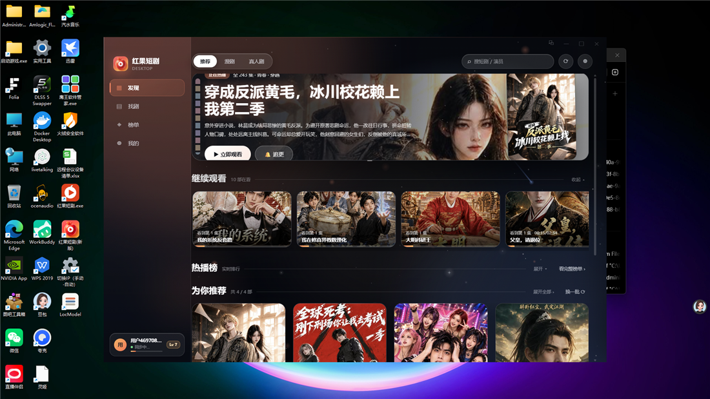

# 红果短剧 · 桌面皮肤版（hongguo-skin）

> 官方客户端一个字没动，功能全保留，只是把那张"呆板的脸"换了。
> 纯前端换皮 + 一层很薄的 C# 外壳，双击 exe 就能用，不需要 Docker、不需要另起服务。

**当前版本：v1.001**（2026-11-21）

## 下载

- 最新版：`v1.001` → https://github.com/guhang42-jpg/hongguo-desktop-skin/releases/tag/v1.001
- 直链：`https://github.com/guhang42-jpg/hongguo-desktop-skin/releases/download/v1.001/hongguo-skin-1.001-win64.zip`
- 文件：`hongguo-skin-1.001-win64.zip`（约 6.6 MB，解压即用）
- SHA256：`8344FC859F0F56462C85510EC4EEE8E736E3CC0BCD66F02B13387AB4DF646F96`

解压后目录长这样：

```
红果短剧.exe                     ← 双击这个
Microsoft.Web.WebView2.Core.dll
Microsoft.Web.WebView2.WinForms.dll
WebView2Loader.dll
core/hongguo-tv-core.exe         ← 官方数据核心，原封不动
ui/index.html, ui/app.js, ui/icon.png
```

## 截图

| 主界面 | 成就 / 等级 |
|---|---|
|  |  |

| 剧场播放 |
|---|
|  |

## 这版有什么

界面：

- 左侧固定导航 + 品牌标 + 底部账号卡；顶部胶囊标签 + 搜索 + 账号
- 大 Hero、继续观看横滑、热播榜带名次横条、推荐瀑布流、底部悬浮播放条
- 整窗毛玻璃质感：半透明材质 + 高光边 + 噪点，深空底色统一，边缘直角不圆润
- 幽光 / 星空 / 流星 / 光尘动态背景，按剧的类型换配色，播放时更活跃，鼠标有视差
- 卡片浮起、封面跟随鼠标打光、按钮涟漪、导航图标缩放等一堆小动效

播放：

- 剧场模式：打开不再抢全屏，视频待在面板里，⛶ 才真全屏
- 真全屏 / 小窗（430×780 置顶、半透明沉浸、控件 2.6 秒自动收起）
- 画面三档：原比例 / 铺满裁剪 / 拉伸
- 控制条一行排开不换行；清晰度直接点；弹幕发送不被挤
- 播完给 5 秒「即将播放 第 N 集」倒计时，可立即 / 取消（不再莫名乱跳集）

成长系统（自娱自乐的小东西）：

- 等级：`need(lv) = 120 + 80(lv-1) + 8(lv-1)²`，9 档称号，越往后越吃经验
- 经验：看 1 分钟 +4、1 集 +8、收藏/追更 +15、弹幕 +4、每日签到 +30、成就 +30
- 45 个成就：完播、连刷、考古回看、题材杂食、时段彩蛋、玩法模式（小窗/全屏/三档/搜索/榜单/云同步）等

## 使用说明

1. 解压到任意目录（别放中文路径的老式短目录，其它都行）
2. 需要 **WebView2 Runtime**（Win10/11 一般自带，没有就装一下微软官方的 Evergreen Runtime）
3. 双击 `红果短剧.exe`，外壳会自动拉起 `core/hongguo-tv-core.exe`，然后打开界面
4. 登录、云同步、追更收藏、播放进度都走官方核心，跟原版共用一份本地数据目录

快捷键：`F` 全屏 / `Esc` 退全屏或小窗 / `空格` 播放暂停 / `/` 搜索框

## 开发碎语

老实说这活儿的起点挺憋屈的：原版是 Wails 打包的，前端被编进 exe 里，发布仓库又不带前端源码，外面根本改不动它的 UI。

好在 `hongguo-tv-core.exe` 本身就是个本地 HTTP 服务，随机端口上既吐它自己的前端，也吐 `/api/v1/*`。我一开始想另起一个静态服务去调接口，结果被跨源挡得死死的——`account`、`library`、`lists/recommend` 一律回"只允许应用本身访问账号和记录"，`file://` 也一样 `Failed to fetch`。

最后的路子很简单：既然不能跨源，那就**不跨源**。C# 外壳把 `coreUrl + "/skin/*"` 拦下来映射到本地 `ui/` 目录，页面依旧算 core 的同源，接口全通。于是官方能力一点没丢，我只需要专心画皮。

踩过的坑，留给以后的自己：

- 封面很多是 HEIC，WebView2 直接摆烂，必须优先用 `cover_fallback` 那张 JPEG
- `play/info` 返回的 codec 是 `bytevc1`，`mode=compat` 没效果，别试了
- 换集时别把上一集的 `currentTime` 带过去，不然新一集一开场就"播完"，看着像自动跳集
- Win11 的 DWM 会给无边框窗口套一层大圆角，得用 `DwmSetWindowAttribute(33/34)` 手动关掉
- 任务栏图标认的是窗口图标，光给 exe 换 `/win32icon` 不够，还得显式 `Form.Icon`

## 已知限制

- 这是**非官方**的第三方界面项目，官方随时可能换接口或核心版本，挂了就等我跟进
- 播放要用官方核心取流，所以第一次启动会多一个后台进程，它是官方的，别误杀
- 4K/杜比这类官方没有的档位自然也没有；1080P 能不能出取决于剧本身

## 免责声明（侵权立删）

- 本项目仅做**客户端界面研究与个人使用**，不包含任何破解、不绕过付费、不二次分发剧集内容。
- 所有影视内容、商标、数据接口版权归**红果短剧 / 番茄**及其权利人所有。`core/hongguo-tv-core.exe` 为官方发布的组件，原样引用，未做修改。
- 本仓库代码仅用于学习交流，**请勿用于商业用途**。
- 若权利人认为本仓库或发布物侵犯其权益，请通过 Issue 或邮件联系我，我会在收到通知后 **24 小时内删除仓库与全部发布物**（侵权立删，不需要解释）。

## 更新日志

### v1.001（2026-11-21）

- 首个对外版本：整套界面重做、幽光流星动态背景、剧场模式、小窗、画面三档、成长成就系统
- 窗口改为直角、整窗配色统一、去掉窗口透明度档位
- 修复换集续播错位导致的"自动乱跳集"，并加播完倒计时提示
- 新 App 图标（含任务栏多档）

## 致谢

- 官方核心 `hongguo-tv-core` 提供的本地接口
- 视觉灵感来自 Folia 的沉浸式播放界面
