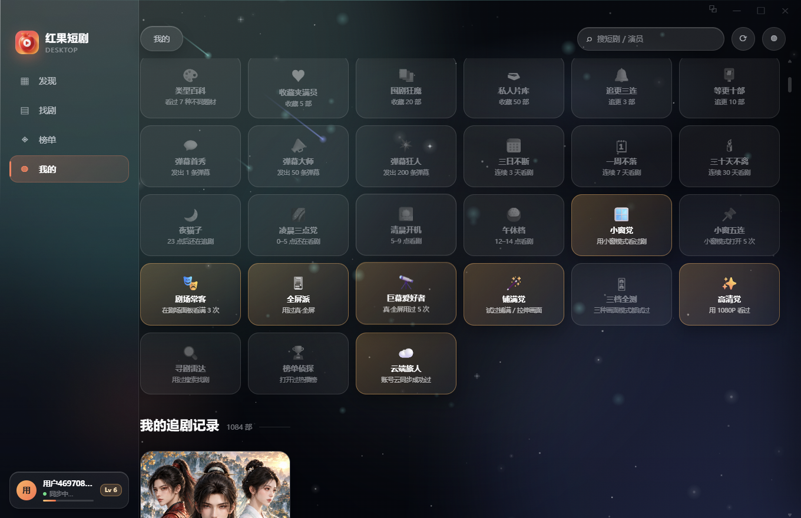
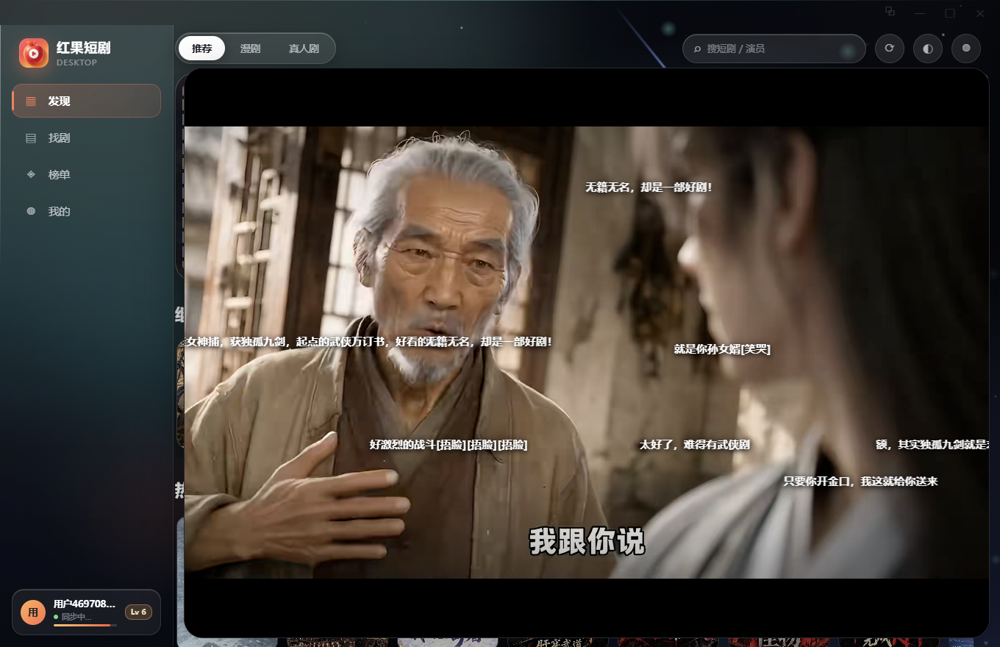
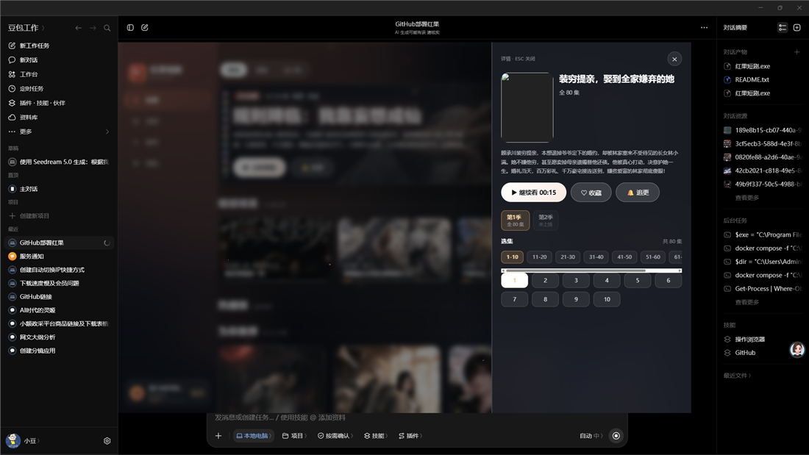

# 红果短剧 · 桌面皮肤版（hongguo-skin）

> 官方客户端一个字没动，功能全保留，只是把那张"呆板的脸"换了。
> 纯前端换皮 + 一层很薄的 C# 外壳，双击 exe 就能用，不需要 Docker、不需要另起服务。

**当前版本：v1.004**（2026-11-22）

## 下载

- 最新版：`v1.004` → https://github.com/guhang42-jpg/hongguo-desktop-skin/releases/tag/v1.004
- 直链：`https://github.com/guhang42-jpg/hongguo-desktop-skin/releases/download/v1.004/hongguo-skin-1.004-win64.zip`
- 文件：`hongguo-skin-1.004-win64.zip`（约 6.6 MB，解压即用）
- SHA256：`00F0BF6DDEC85E634CC0AB69D698E30EB7144493AB10A106AC9B5157609125F6`
- 上一版（v1.003）：https://github.com/guhang42-jpg/hongguo-desktop-skin/releases/tag/v1.003

> **换到别的 Windows 电脑上播放只有声音、画面全黑？** 那台机器缺 HEVC 解码器（片源是 H.265）。
> 启动后顶上会顶出一条橙色提示，点「去安装」拉商店装 `HEVC Video Extensions`（￥0），装完点「装好了，重启」即可。


解压后目录长这样：

```
红果短剧.exe                     ← 双击这个
Microsoft.Web.WebView2.Core.dll
Microsoft.Web.WebView2.WinForms.dll
WebView2Loader.dll
core/hongguo-tv-core.exe         ← 官方数据核心，原封不动
ui/index.html, ui/app.js, ui/icon.png
```

## 截图

| 主界面（折叠后） | 成就 / 等级 |
|---|---|
|  |  |

| 剧场播放 | 详情：多季切换 + 选集分段 |
|---|---|
|  |  |

## 这版有什么

界面：

- 左侧固定导航 + 品牌标 + 底部账号卡；顶部胶囊标签 + 搜索 + 账号
- 大 Hero、继续观看横滑、热播榜带名次横条、推荐瀑布流、底部悬浮播放条
- **首页折叠**：热播榜默认收起、推荐区只露两行，点了才展开；找剧 / 榜单 / 我的页不再摆 Hero 和两条横滑
- **找剧细化**：排序（推荐 / 热度 / 口碑 / 集数少 / 集数多）+ 集数段（≤40 / 41–80 / 80+）+ 题材标签（从已加载剧集里统计出的热门前 10）
- **榜单细化**：综合榜 / 真人剧榜 / 漫剧榜 / 官方推荐榜 + 官方推荐序 / 最热播 / 口碑高 / 短剧精选 / 长剧专场；卡片左上角有名次牌（前三金 / 银 / 铜），跟上次打开时的顺序比对出名次涨跌
- **详情页多季切换**：同一部剧的第 1..N 季横排，点了直接换季；未上线的续季灰着并提示
- **选集按 10 集分段**：长剧不再一次铺几十个按钮，`1-10 / 11-20 …` 分段条，看过的集标成暖色
- 整窗毛玻璃质感 + 深空底色统一，窗口边缘直角不圆润（Win11 的 DWM 圆角也关掉了）
- 幽光 / 星空 / 流星 / 光尘动态背景，按剧的类型换配色，播放时更活跃，鼠标有视差

播放：

- **打开即真全屏 + 铺满裁剪 + 自动播放**（想回面板方式，把 `ui/app.js` 里的 `AUTO_FS` 改成 false）
- **播完直接接下一集**：没有读秒倒计时，画面原地换源，不退回面板、不闪海报
- **每集都从头开始**：换集先卸旧源再归零，实测三集 `t0 = 0.00`
- **续播记忆**：同一集看到一半退出，下次点这集从上次位置继续；详情页播放键会写「继续看 00:15」，看过的集在选集中标暖色
- **倍速 + 音量**：`1.0× / 1.25× / 1.5× / 2× / 0.75×` 循环（`R`），音量有滑条（点喇叭弹出，拖完记住），滚轮也能调，`M` 一键静音
- 小窗（430×780 置顶、半透明沉浸、控件自动收起）与全屏互切不再打架：两种形态互斥，退出全屏会退回你来的那个形态
- 画面三档：原比例 / 铺满裁剪 / 拉伸
- 弹幕默认开，`D` 开关（原来顶部那颗「弹幕 开」按钮已拿掉，不占位置）
- 单集播到最后一个会提示「已经是最后一集」，不会无声停住

成长系统（自娱自乐的小东西）：

- 等级：`need(lv) = 120 + 80(lv-1) + 8(lv-1)²`，9 档称号，越往后越吃经验
- 经验：看 1 分钟 +4、1 集 +8、收藏/追更 +15、弹幕 +4、每日签到 +30、成就 +30
- 45 个成就：完播、连刷、考古回看、题材杂食、时段彩蛋、玩法模式（小窗/全屏/三档/搜索/榜单/云同步）等

## 使用说明

1. 解压到任意目录（别放中文路径的老式短目录，其它都行）
2. 需要 **WebView2 Runtime**（Win10/11 一般自带，没有就装一下微软官方的 Evergreen Runtime）
3. 双击 `红果短剧.exe`，外壳会自动拉起 `core/hongguo-tv-core.exe`，然后打开界面
4. 登录、云同步、追更收藏、播放进度都走官方核心，跟原版共用一份本地数据目录

快捷键：`F` 全屏 / `Esc` 退全屏或小窗 / `空格` 播放暂停 / `←` `→` 上一集下一集 / `D` 弹幕 / `R` 倍速 / `M` 静音 / `/` 搜索框

## 开发碎语

老实说这活儿的起点挺憋屈的：原版是 Wails 打包的，前端被编进 exe 里，发布仓库又不带前端源码，外面根本改不动它的 UI。

好在 `hongguo-tv-core.exe` 本身就是个本地 HTTP 服务，随机端口上既吐它自己的前端，也吐 `/api/v1/*`。我一开始想另起一个静态服务去调接口，结果被跨源挡得死死的——`account`、`library`、`lists/recommend` 一律回"只允许应用本身访问账号和记录"，`file://` 也一样 `Failed to fetch`。

最后的路子很简单：既然不能跨源，那就**不跨源**。C# 外壳把 `coreUrl + "/skin/*"` 拦下来映射到本地 `ui/` 目录，页面依旧算 core 的同源，接口全通。于是官方能力一点没丢，我只需要专心画皮。

踩过的坑，留给以后的自己：

- 封面很多是 HEIC，WebView2 直接摆烂，必须优先用 `cover_fallback` 那张 JPEG
- `play/info` 返回的 codec 是 `bytevc1`，`mode=compat` 没效果，别试了
- 换集时别把上一集的 `currentTime` 带过去，不然新一集一开场就"播完"，看着像自动跳集
- Win11 的 DWM 会给无边框窗口套一层大圆角，得用 `DwmSetWindowAttribute(33/34)` 手动关掉
- 任务栏图标认的是窗口图标，光给 exe 换 `/win32icon` 不够，还得显式 `Form.Icon`

## 已知限制

- 这是**非官方**的第三方界面项目，官方随时可能换接口或核心版本，挂了就等我跟进
- 播放要用官方核心取流，所以第一次启动会多一个后台进程，它是官方的，别误杀
- 4K/杜比这类官方没有的档位自然也没有；1080P 能不能出取决于剧本身

## 免责声明（侵权立删）

- 本项目仅做**客户端界面研究与个人使用**，不包含任何破解、不绕过付费、不二次分发剧集内容。
- 所有影视内容、商标、数据接口版权归**红果短剧 / 番茄**及其权利人所有。`core/hongguo-tv-core.exe` 为官方发布的组件，原样引用，未做修改。
- 本仓库代码仅用于学习交流，**请勿用于商业用途**。
- 若权利人认为本仓库或发布物侵犯其权益，请通过 Issue 或邮件联系我，我会在收到通知后 **24 小时内删除仓库与全部发布物**（侵权立删，不需要解释）。

## 更新日志

### v1.004（2026-11-22）

- 修小窗：`body.theater` 的 `.viewer{left:236px}` 残留把 430 宽窗口挤成 178 宽画面区，进小窗时摘掉该类 + CSS 四边清零兜底
- 小窗窗口尺寸改为跟片源比例走：横屏 560×315、竖屏 430×764，`cover` 铺满不裁人；尺寸写入 `hg_mini_size`，下次进小窗先按上次的
- 修小窗底部控件挤成四行：`#vQual` 的内联 `display:flex` 压过 CSS，改 `!important` 后只留必要按钮
- 进小窗时 `MinimumSize` 从 300×420 放到 260×200，横屏矮条不再被高度下限拦下
- 自检 `?mini=1` 不再被「打开即全屏」抢占形态

### v1.003（2026-11-22）

- 修「换到别的电脑有声音没画面」：片源是 H.265，WebView2 得靠系统 Media Foundation 解，那台机器缺 HEVC 扩展
- 启动自检 `canPlayType('hvc1'/'hev1')`，缺解码器直接顶提示条，写明原因
- 提示条「去安装」一键拉商店 `HEVC Video Extensions`（￥0 设备制造商版，商店搜不到，只能直链进），「装好了，重启」自带重启
- WebView2 传 `--enable-features=PlatformHEVCDecoderSupport`，修「扩展装了但内核没开平台解码」那种黑屏
- 播放兜底：`videoWidth` 一直为 0 就判定有声音没画面，再把提示条顶上来

### v1.002（2026-11-21）

- 播放器：去掉播完的 5 秒读秒，直接无缝接下一集（原地换源，不闪海报、不退回面板）
- 打开播放默认真全屏 + 铺满裁剪；退出全屏回到你来的形态（小窗或剧场面板）
- 修「每集不是从头播」：换集先卸旧源再归零，实测 `t0 = 0.00`
- 修小窗 ↔ 全屏互切的尺寸 / 形态打架；修换集时误亮的白色暂停键
- 顶部「弹幕 开」按钮拿掉，改 `D` 键切换
- 新增续播记忆、详情页多季切换、选集 10 集分段、倍速与音量滑条
- 首页折叠、找剧与榜单的分类 / 筛选、榜单名次牌与涨跌标记
- 本地记忆统一走固定端口 `18797`（避开官方 8797），端口被占则自动回退随机端口（仅丢本地记忆）

### v1.001（2026-11-21）

- 首个对外版本：整套界面重做、幽光流星动态背景、剧场模式、小窗、画面三档、成长成就系统
- 窗口改为直角、整窗配色统一、去掉窗口透明度档位
- 修复换集续播错位导致的"自动乱跳集"，并加播完倒计时提示
- 新 App 图标（含任务栏多档）

## 致谢

- 官方核心 `hongguo-tv-core` 提供的本地接口
- 视觉灵感来自 Folia 的沉浸式播放界面
