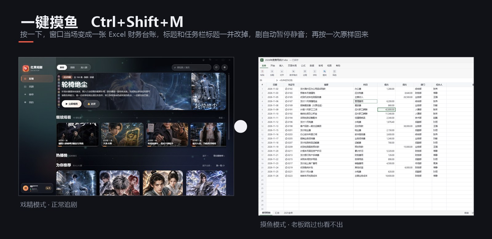

## 红果短剧 · 桌面皮肤版 v1.006

这一版主要是**把你等过的那几十秒补上**，顺手把侧边栏和提示都换了新样子。官方 `hongguo-tv-core` 一个字没动，解压双击 `红果短剧.exe` 就能用。

**下载**：`hongguo-skin-1.006-win64.zip`（约 6.6 MB）
SHA256 `4A5E472186DCDAF819CA8C0F55D24D63024CE38B0ADEC9DEFDA87BCE50FF2088`

---

### 修：有的剧点开一直转圈

查下来不是播放器坏了，是**官方 core 第一次给某部没缓存过的剧取流特别慢**——《就我在修仙啊？》首集实测 **56 秒**才拿到地址，同一集第二次 0 秒（core 落盘缓存），该剧第 2 集 18.6 秒，别的剧 26.9 秒。旧前端没超时、没提示、出错还没人接，于是就是那个无限转圈。

现在的做法：

- **取流超时 75 秒**，超了直接给红字错误态 +「重试」按钮，不再转没完
- **同一集只取一次**：成功结果进内存缓存，重复点、来回切都秒开
- **提前取**：点开剧详情就开始预取第 1 集；鼠标在剧卡上停 0.7 秒也会去预取（继续观看卡片 0.6 秒）；播起来 4 秒后自动预取下一集，等你看下一集时已经在路上
- **等的时候有人说话**：4 秒「正在解析播放源…」→ 14 秒「这部剧没缓存过，第一次要十几秒」→ 40 秒「还在等…」，旁边 spinner 不再被那颗大暂停键压住
- 缓冲中（`waiting` 事件）也补了「画面缓冲中…」

实测日志：`stream req ep46 9219ms`（预取命中）、`stream req ep1 1039ms`、`ep3 808ms`。

### 新：侧边栏重做 + 提示变顶部「灵动岛」

- 侧栏加了玻璃质感双色氛围光和右缘一条细亮线，不再是死板的纯色块
- **品牌标**：外圈一道彩环慢转 + 西瓜标呼吸
- **四个导航**：悬停时从左展开一枚橙色胶囊、左侧亮条同步升起、字距微开；选中态整块透亮 + 呼吸光
- **底部账号卡**：渐变流光 + 斜向扫光，头像外挂一道转着的细光环，等级变成发光小胶囊
- **提示全改成顶部灵动岛**：一条黑胶襄从大到小展开、左侧橙点脉冲，连续弹多条会重播一次「回应」动画；全屏播放时自动下移 62px 不挡控制条，小窗里等比缩小，摸鱼态直接隐藏（不穿帮）

### 顺手

- 截图/发图用 `--mask`：昵称显示 `用户****`、账号面板显示「账号：已隐藏（截图用）」
- 自检参数 `--slow`（人为把取流放慢 12 秒，核对等待文案）、`--tip`（弹一条常驻提示核灵动岛样式）、`--dbg`（日志把每次取流耗时打到 `app.log`）

### 已知

- 没装 **HEVC 视频扩展**的机器（H.265 片源）会有声无画，装 `Microsoft.HEVCVideoExtension` 后正常
- 首次遇到冷门剧仍可能要等十几秒，那是 core 在下载，界面会告诉你等多久
