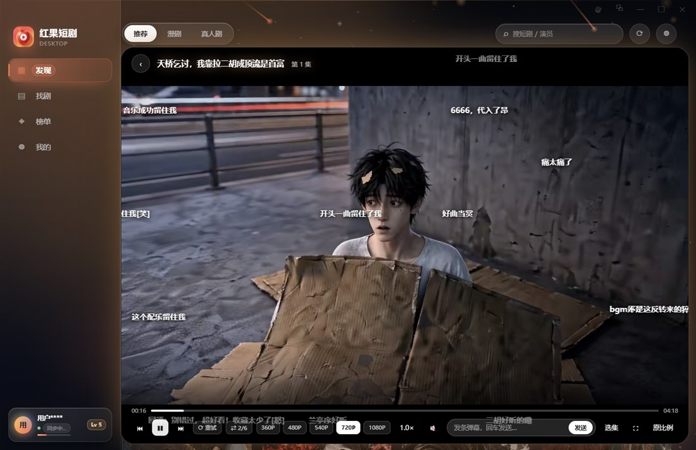

## 红果短剧 · 桌面皮肤版 v1.007

这版给播放器加了**换源**：播不出来就换一条取流线路，不用关掉重开。官方 `hongguo-tv-core` 依旧一个字没动。

**下载**：`hongguo-skin-1.007-win64.zip`
SHA256 `2F7FFE9464F65D55919CAF3870B0477A79ABA81E01F0817F56CEBD7F475A8028`

---

### 换源是换什么

官方 core 没有公开"多线路"参数，但实测 `quality` × `mode` × `fallback` 的不同组合在它内部是**几条独立的上游请求**——每种组合都会生成不同的本地代理文件（`/minireel-proxy/media/<另一串 hash>.mp4`），走的缓存和请求也不一样。所以能换的"源"就是这几种组合：

| 线路 | 画质 | 取流方式 |
|---|---|---|
| 1 | 720P | 完整 · 备用接口 |
| 2 | 720P | 分段 · 备用接口 |
| 3 | 540P | 完整 · 备用接口 |
| 4 | 480P | 完整 · 备用接口 |
| 5 | 360P | 完整 · 备用接口 |
| 6 | 1080P | 完整 · 备用接口 |

- 控制条多了一颗 `⇄ 2/6`：点一下换下一条，走到末尾绕回来
- **快失败会自动往下换**（几秒内报错的），一条路等满 75 秒的不会自动乱试，交给你点
- 换过又能出流的线路会**记住**，下次开局直接用这条（存在本机，不动别人的设置）
- 失败态从"一句话"变成一张卡片：`⇄ 换个源` / `⟳ 重试`，并写明"现在是第 6/6 路（超清·完整）"

顺便把 `quality` 与 `mode` 都写进缓存键，换源不会互相覆盖；预取也按当前线路走，命中率更高。

### 顺手

- 所有取流请求默认带 `fallback=1`（让 core 走它的备用上游接口），失败率比之前低
- 新增自检参数 `--src N`（开机直接用第 N 路）、`--fail`（模拟取流失败，核错误态与换源按钮）

### 仍然要说清的两件事

- **换源救不了"有声无画"**：那是 H.265（`video_codec: bytevc1`）缺解码器，六条线路全都是 H.265，装 `HEVC Video Extensions` 才是解法
- **第一次遇到冷门剧还是可能等十几秒**：那是 core 在现拉片源，界面会告诉你等多久；拉过一次就落盘了
