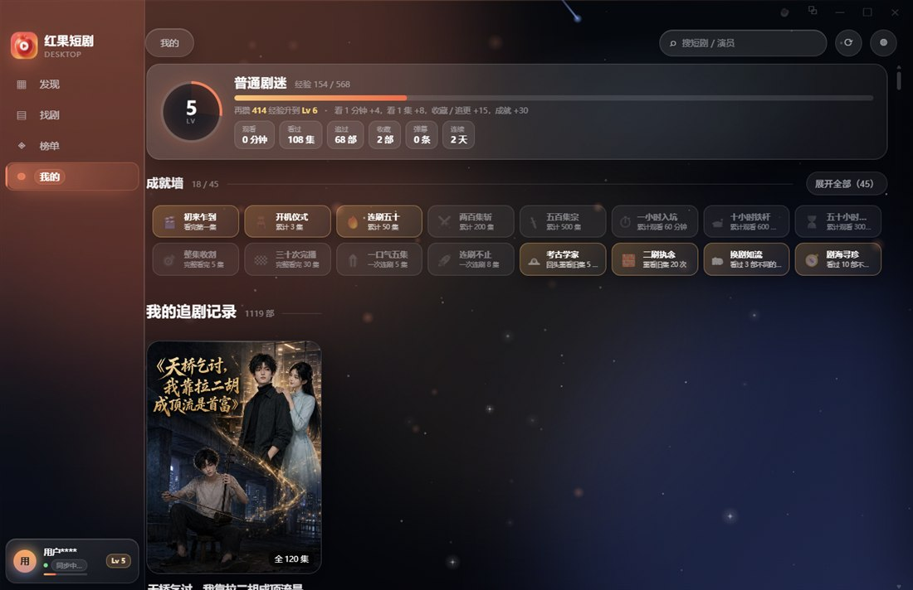

## 红果短剧 · 桌面皮肤版 v1.008

这版全是界面手感：**边距收窄**、**成就墙折叠压缩**，顺手修了一个「点了我的又被首页覆盖」的竞态。

**下载**：`hongguo-skin-1.008-win64.zip`
SHA256 `DFBBE7708155652499FF554FF4D4790F6802FDD939E70E10DF923C123ABBC055`

---

### 边距收窄

- 侧栏 236 → **216**，栏内左右留白 16 → 8，顶部 8 → 4，导航行高 46 → 42
- 主区右侧留白 26 → **16**，顶栏上下 10/12 → 8/10
- 剧场模式播放器左边距同步跟到 216，不会错位

结果就是内容真的贴着窗口走，不再有一圈"宽边"，一屏能多出一列卡片。

### 成就墙：默认只露两排

- 卡片从「竖着排的 162×大块」改成**横向小条**（图标 + 标题 + 说明一行，128 宽），高度从 88 掉到 40 左右
- 默认**折叠**显示前 16 个（8 列 × 2 行），标题行右边一颗 `展开全部（45）`，点一下全铺开、再点收起
- 等级卡一起压：圆环 114 → 92、内边距 22→15、六个统计胶囊更小，一屏就能看到"等级 + 成就 + 追剧记录"开头
- 说明长的一律单行省略，鼠标悬停有完整描述（原生 tooltip）

### 修：切到「我的」又被首页内容顶掉

`switchView` 原来不改 `S.view`，首页 `lists/recommend` 晚回来时判断不出"人已经切走"，会把 grid 重填成首页那批剧（点得快就会看到我的页突然变成首页列表）。现在切换视图第一件事就记账，晚到的响应直接丢弃。

### 自检

- `--ach`：启动切到「我的」并滚到成就墙，用来核折叠样式（日志里 `diag view=… lvwrap=… achGrid=…`）
