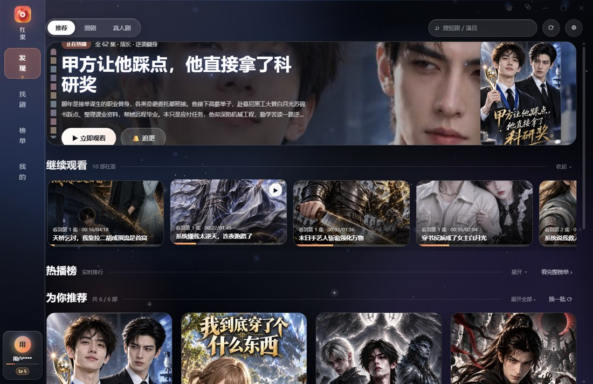
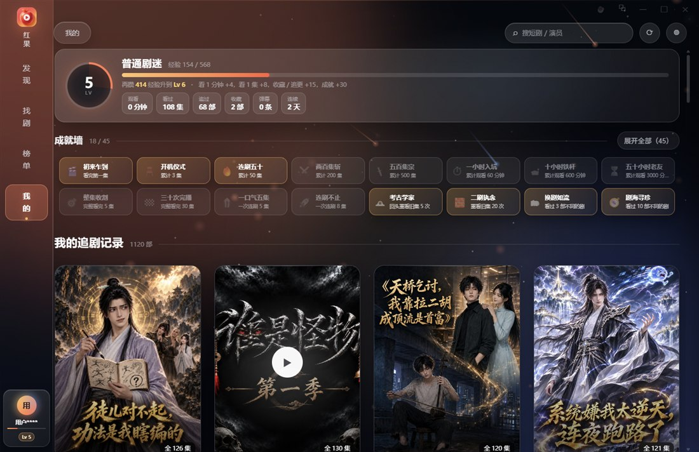

## 红果短剧 · 桌面皮肤版 v1.009

主界面换骨：**左侧一条窄栏，导航全部改成竖排字**。顺手把「我的」页那个塌成一条窄列的老毛病修了。

**下载**：`hongguo-skin-1.009-win64.zip`
SHA256 `0379B9175BA42C064309F2B1009F54CE5A20FCF8E3AC96ADAE166E5AAB54B75D`

---

### 侧栏：竖排单列

- 宽度 216 → **104px**，图标全部拿掉，只留竖排的字：发现 / 找剧 / 榜单 / 我的，一个一个字往下叠，行距 1.62
- 当前项是一块竖向圆角胶囊，字下面一颗呼吸的小橙点；鼠标划过时胶囊从中间纵向展开（`transform:scaleY`），不是整块亮起来
- 品牌区收成"图标 + 竖排『红果』"，账号卡也改成竖着排：圆形头像、名字单行省略、下面细经验条 + Lv 徽章
- 剧场播放器和全屏播放的左边距跟着 `--railw` 变量走，不会再错位

一屏内容变宽的差距：主区从 1134 涨到 **1246**，原来「为你推荐」一排 4 张，现在能放 5 张。

### 修：「我的」页整块塌成一条 290 宽的窄列

`renderMine()` 里那个包着"追剧记录 / 我的收藏"的 wrap 容器漏了 `grid-column:1/-1`，被 `#grid` 当成普通卡片塞进了第一列 —— 结果上千部追剧记录挤在一列里往下排，右边一片空白，看着就是"乱"。

加上跨列之后，追剧记录恢复 4 列满铺，「我的收藏」也露出来了。

### 成就墙

- 卡片内两行文字间距 1px → 3px，不再贴在一起
- 上下内边距 9 → 10，卡片略高 2px，字不再压边

### 自检

`--mine` 会切到「我的」页；`rail6/7/8` 这组截图就是用它抓的（`vw=1360x880 main=1230 content=1256 grid=1216`）。
