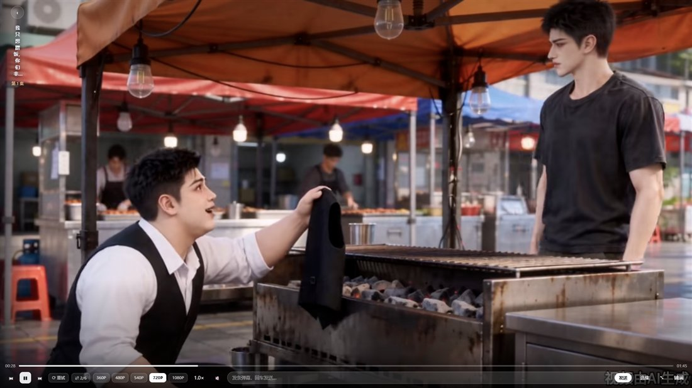
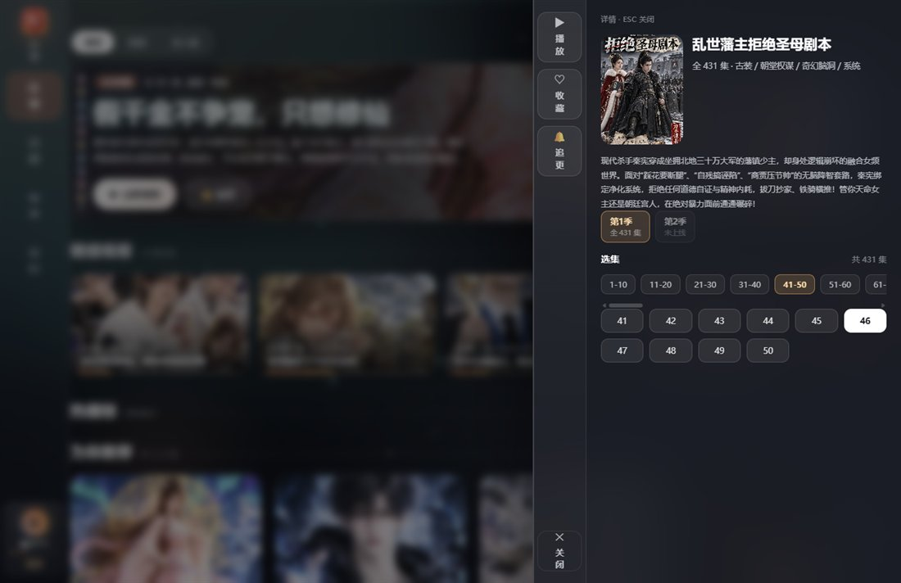

## 红果短剧 · 桌面皮肤版 v1.010

竖排这套视觉终于推到**全屏播放器**和**详情页**了，三处现在是同一种语言。

**下载**：`hongguo-skin-1.010-win64.zip`
SHA256 `8D47F0D60D1CA8B6CDF312AB4A994EF72B7311B9532CF1789626D74AAD9602E1`

---

### 播放器：左侧竖排栏

- 顶部那条横向标题栏整条搬成**左侧竖向 96px 的栏**：返回按钮在上、剧名一列往下叠、集数在下面一行
- 长剧名超过 10 个字截断加省略号（完整标题还留在 DOM 里），不会变成一根"字柱子"
- 全屏时跟以前一样"鼠标动才浮出来"，静止就隐去，不挡画面；剧场模式常驻
- 背景从原来的横向黑色压暗改成从左往右渐隐，竖栏边缘不割画面

### 详情页：左侧竖排操作栏

- 「从头播放 / 收藏 / 追更」三个横排大按钮改成**竖排一列**：图标在上、两字竖排在下，播放那颗是橙色实心
- 关闭按钮从右上角 ✕ 挪到竖栏底部，跟其他操作同一列
- 抽屉宽度 474 → **556**，补回竖栏吃掉的 80px，选集分段条不会被切
- 收藏 / 追更的状态改成两字（收藏 ↔ 已藏、追更 ↔ 已追），竖排下才立得起来

### 顺带的

- `renderMine()` 的容器修复、竖排主界面都在 v1.009，这版不重复
- 自检 `--demo` 现在会把左侧竖栏强制露出（`body.vtopshow`），否则全屏静止状态下截不到

### 一个已知取舍

播放器的竖栏固定 96px，压住的是画面最左边一窄条。9:16 竖剧在 16:9 屏上两侧本来就有黑边，所以实际不压内容；但如果哪天做 16:9 横屏素材，这里要改成"只在 hover 时占位"。
